# ADA PMS — Architecture, End-to-End Workflow and Configurable Process Workflows

> **Version:** 2.0 target-state workflow specification  
> **Status:** Proposed implementation specification — not yet verified as implemented  
> **Organization:** Aeronautical Development Agency (ADA)  
> **Legacy reference:** ProFlow v2.0 workflow behaviour  
> **Target architecture:** React + TypeScript / Python FastAPI / PostgreSQL / Docker / intranet  
> **Related master context:** `ADA_PMS_PROJECT_CONTEXT.md`

---

## 0. Purpose, Scope and Interpretation

This document describes how the ADA Process Management System (PMS) should route work, manage documents, review and approve revisions, sign and release deliverables, track programme/project progress, and preserve the existing ProFlow SDLC workflow capabilities.

The target system must support multiple directorates and departments, multiple projects/programmes (for example AMCA and Mk1), and multiple process domains (software, hardware, hybrid and other ADA-configured domains).

**Critical design rule:** workflows are configured data, not hard-coded code paths. Diagrams below describe reference workflows. An ADA-authorized process administrator must be able to configure different stages, forms, roles, routing rules, approval chains, signature requirements and release gates for each process domain, project, directorate or document type.

### 0.1 What is source-derived and what is target design

- The SDLC modules and legacy lifecycle details in §8–§15 are retained from the supplied ProFlow documentation.
- The ADA hierarchy, cross-directorate document decomposition, configurable hardware/engineering flows, centralized Release Register, formal signature handling and air-gapped target architecture are new target-state requirements from the supplied ADA scope.
- The exact ADA policy, PKI profile, role definitions, classification labels, document taxonomy and hardware engineering lifecycle were not supplied. The workflow engine must support these as configuration; example values are not mandatory policy.

### 0.2 Table of Contents

1. Operating model and scope hierarchy
2. Target system architecture and request path
3. Login, organization context and dashboard routing
4. End-to-end ADA document and work-package flow
5. Workflow engine configuration and versioning
6. Common document lifecycle
7. Cross-directorate document sharing and Release Register
8. Review, approval and digital signature
9. Programme/project planning and tasks
10. Requirement management
11. Design and engineering artefacts
12. Software development
13. Testing, verification and defects
14. Deployment and software release
15. Hardware / engineering process template
16. Maintenance and in-service change workflow
17. Dashboards, completion calculation and reports
18. Notifications, SLA and escalations
19. Traceability, baselines and configuration control
20. Integration workflows
21. Audit, security and failure behaviour
22. Configuration examples
23. Acceptance scenarios
24. Implementation sequence and test checklist

---

## 1. Operating Model and Scope Hierarchy

### 1.1 Organization hierarchy

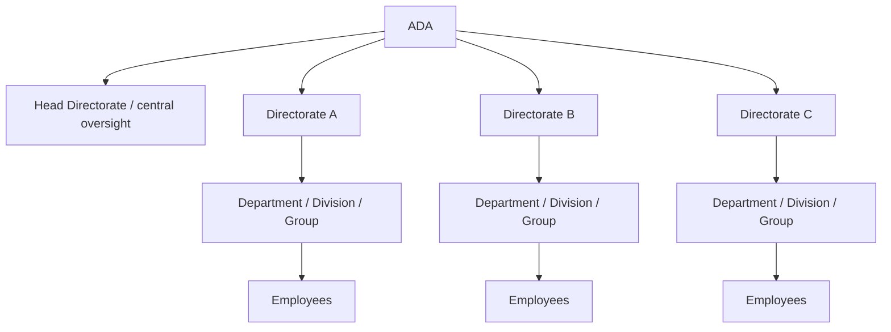

The exact directorate and department list is managed as master data. Directorate names shown in the source requirement (Admin, AWS, ICT, etc.) are examples and must not be fixed in source code.

### 1.2 Programme and product hierarchy

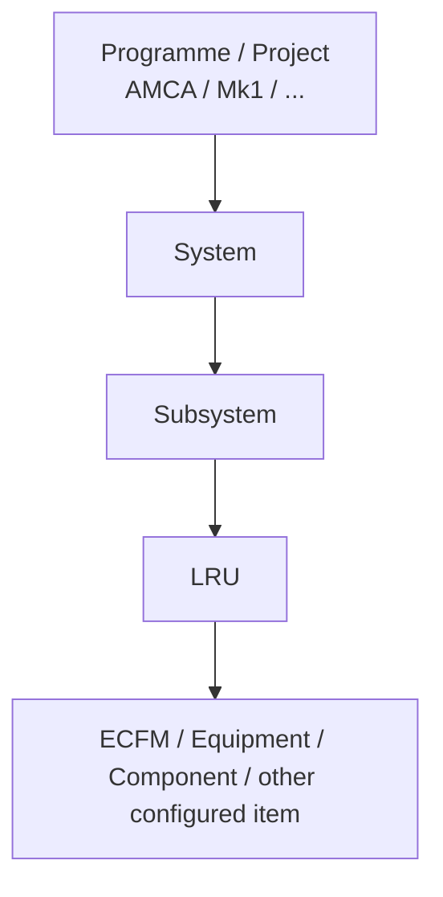

The supplied example **AMCA → LRU → ECFM** must be supported. System and subsystem levels, naming and parent-child constraints must be configurable because projects may use different product breakdown structures.

### 1.3 Work context

Every process instance must have a clear context where applicable:

- Programme/project.
- Owning and contributing directorates.
- Department or group.
- Process domain: software, hardware, hybrid or configured domain.
- System/subsystem/LRU/component.
- Document, work package, task or engineering deliverable.
- Workflow definition and published version.
- Data handling/classification label, if defined by ADA.

A user may participate in several scopes with different roles. Do not assume one user = one directorate or one project.

---

## 2. Target System Architecture and Request Path

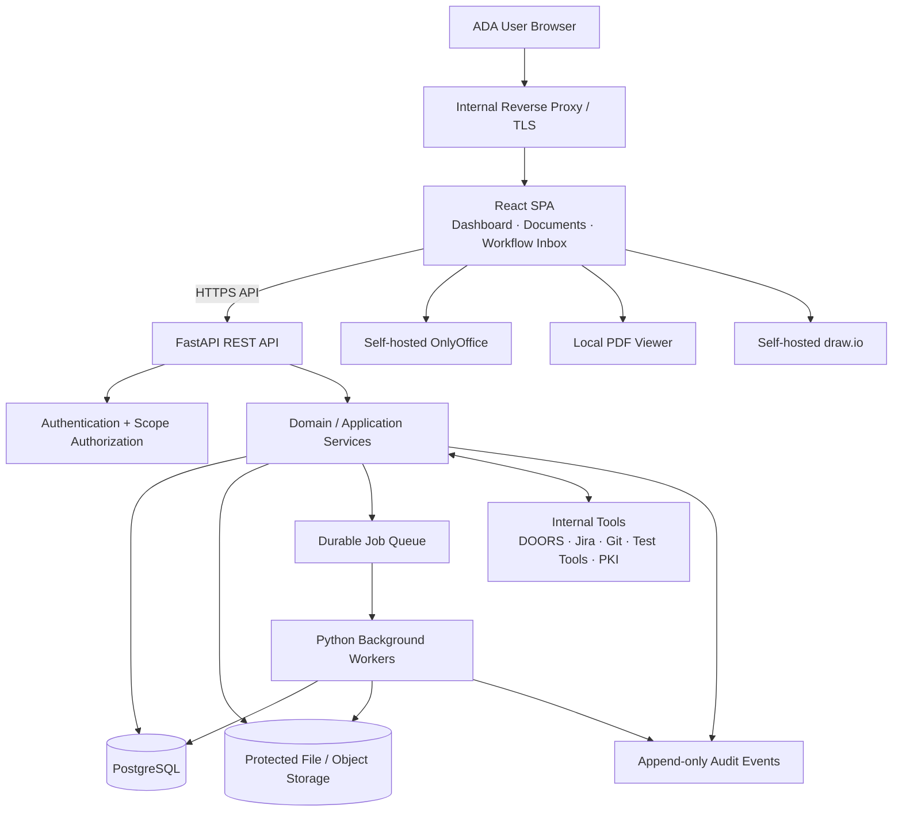

### 2.1 Runtime principles

- React is the presentation layer; it must not contain business authorization rules as the only security control.
- FastAPI is the authoritative entry point for business commands and data retrieval.
- Workflow decisions, document state transitions, approvals, signatures and releases are validated server-side.
- Workers perform asynchronous tasks but use shared domain services and audit behaviour.
- PostgreSQL is the source of truth for metadata and workflow state; protected file/object storage is the source of truth for file bytes.
- Redis may be used as a job broker/cache if selected, but must not be the only store for business events or job state.
- OnlyOffice, PDF viewer and draw.io must be hosted on the intranet and bundled for offline operation.
- No runtime public CDN, public API, external login or public telemetry is required.

---

## 3. Login, Organization Context and Dashboard Routing

### 3.1 Login and context resolution

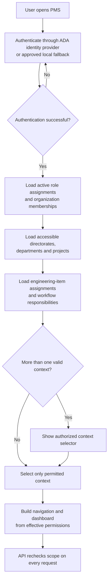

A context selector changes the user's current view; it never grants more access. The backend must re-evaluate effective permissions for every API and every file stream.

### 3.2 Role-aware and scope-aware landing areas

| Audience / scope | Default dashboard content |
|---|---|
| Head Directorate / central oversight | Programme health, directorate-wise completion, cross-directorate issues, upcoming releases, pending high-level reviews, Release Register |
| Directorate Head | Directorate portfolio, department delivery, document review/release status, dependencies and overdue work |
| Department Head | Department tasks, activity documents, team workload, review actions, due dates |
| Project Director / Project Manager | Milestones, phase progress, directorate contribution, document/release readiness, risks and decisions |
| PGD / TD | Configurable oversight or technical portfolio widgets according to ADA-approved role mapping; do not hard-code acronym meaning |
| Project Engineer / Technical Owner | Assigned project/system/subsystem/LRU, requirements, design, work packages, documents, reviews and test evidence |
| Team Member | My work items, created documents, action inbox, reviews, assigned test cases and due dates |
| Quality / Process / Audit | Workflow compliance, overdue reviews, baseline/release audit, non-conformities and process reports |
| Administrator | Organization, users, roles, workflow templates, integrations and system health; approval authority is separate |

### 3.3 Conditional module availability

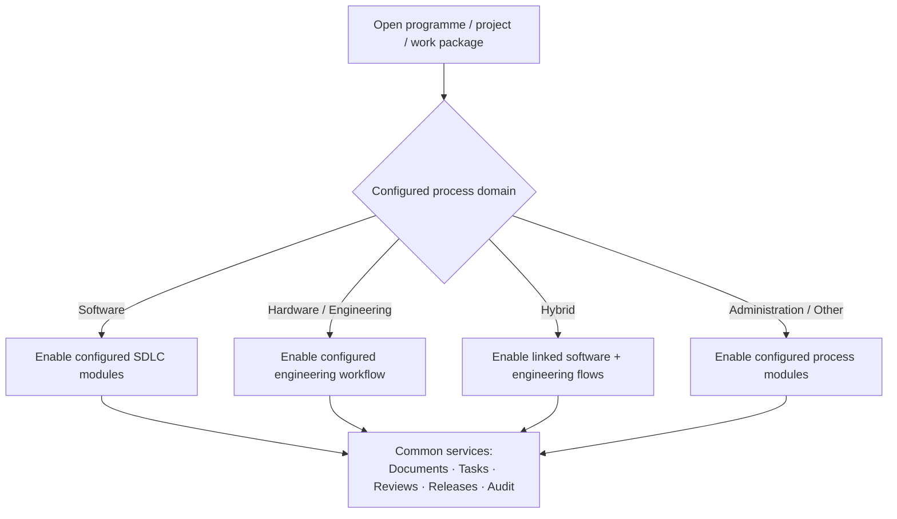

A project may have software and hardware work packages in parallel. Enablement is therefore determined at the work-package/process-instance level when needed, not solely by one project-level Boolean.

---

## 4. End-to-End ADA Document and Work-Package Flow

### 4.1 Typical multi-level document decomposition

A top-level document from Head Directorate or programme authority is registered in PMS. It may be decomposed into second-level documents and then into directorate/department activity documents. Each child document preserves its parent/source relationship.

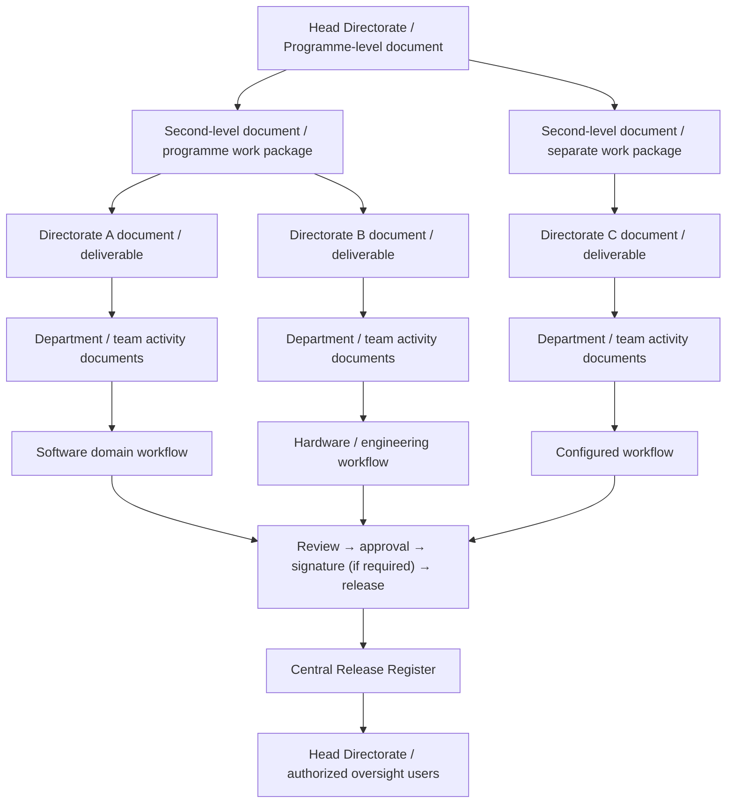

### 4.2 End-to-end process

1. **Register source document:** Head Directorate or authorized originator creates/imports a document with metadata, project, directorate, type, source, revision and distribution scope.
2. **Validate and classify:** PMS validates required fields, file type, document number, access label and project/product references.
3. **Decompose work:** authorized owner creates child documents, tasks or work packages and assigns responsible/contributing directorates.
4. **Route to domain:** each child/work package gets its domain and a published workflow version (software, hardware, hybrid or other).
5. **Assign ownership:** assign responsible directorate, department, preparer, reviewer roles, technical owner, due dates and dependencies.
6. **Prepare deliverable:** team members create/update document revisions, requirements, designs, code, test evidence or other domain artefacts.
7. **Perform stage reviews:** each configured review stage receives an assignment and performs its decision against an exact revision.
8. **Rework if needed:** changes requested return to configured rework stage with comments; new revision is created and affected reviews are repeated as defined.
9. **Approve:** all mandatory review and approval gates must be completed.
10. **Sign:** invoke the approved ADA signature provider for each required signatory and validate signature evidence.
11. **Release:** release authority validates checklist and package manifest, then registers the exact approved/signed revision(s).
12. **Central visibility:** authorized Head Directorate users find released documents in the central Release Register.
13. **Maintain history:** revisions, child relationships, status transitions, sharing, access, approvals, signatures, releases and withdrawals remain auditable.

### 4.3 Parent/child relationship rules

- Parent and child documents have independent identities, revision histories, owners and workflows.
- The relationship must record `parent_document_id`, relationship type, created-by, created-at and optional explanation.
- A parent may have multiple children across directorates and departments.
- A child may reference multiple source documents, but its primary parent (if required by policy) must be explicit.
- A parent approval does not automatically approve a child.
- Parent status should be calculated from child status using a configurable roll-up rule; do not automatically mark a parent complete when one child is complete.
- Parent changes can trigger impact assessment and affected-child notifications. They must not silently overwrite children.
- A child revision records which parent revision(s) it was derived from.

---

## 5. Workflow Engine Configuration and Versioning

### 5.1 Workflow assignment dimensions

An administrator may bind a workflow to:

- Process domain.
- Project/programme.
- Directorate or department.
- Work-package type.
- Document type/subtype.
- Engineering-item type/level.
- Release type or environment.
- Risk/classification/other approved metadata conditions.

The most specific valid published workflow mapping wins according to an explicitly configured precedence rule. Ambiguous or conflicting mappings must fail validation rather than silently choose one.

### 5.2 Workflow definition components

| Component | Required configuration |
|---|---|
| Identity | Name, code, description, owner, version and active state |
| Applicability | Domain, project/directorate/department, document/work-package type and conditions |
| States | State code, display name, category, entry/exit definition |
| Transitions | From, to, action label, allowed role/scope, guard condition |
| Form | Required fields, data types, validations, visibility and editability per stage |
| Assignment | Role, named user/group, responsible organization, assignment strategy |
| Approval mode | Sequential, parallel, all-must-approve, quorum or conditional |
| Review checklist | Required checklist, review criteria and comment requirements |
| SLA | Working calendar, due period, reminder, escalation and reassignment |
| Signature | Required signatory role, signature provider and validation policy |
| Release | Release authority, required records/documents, checklist and target register |
| Completion | Stage weight and roll-up behaviour for dashboard calculations |
| Notifications | Events, templates, recipients and delivery channels |
| Exceptions | Reopen, cancel, withdraw, delegate, suspend and emergency bypass policy |

### 5.3 Workflow definition lifecycle

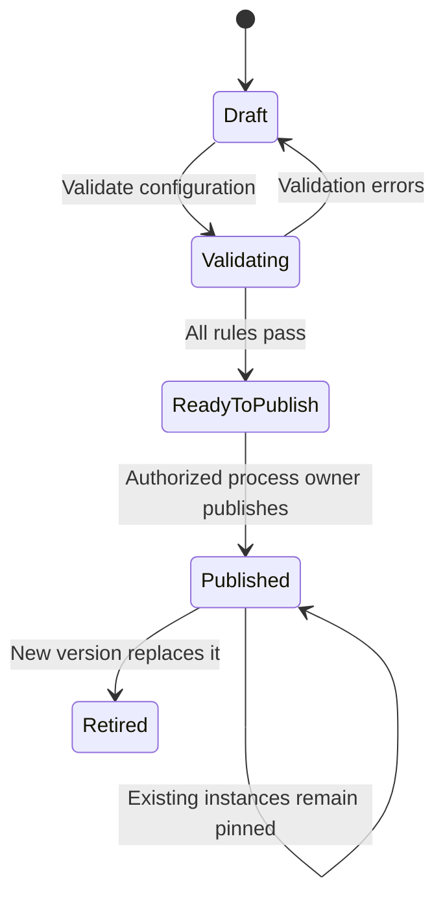

- Published versions are immutable.
- Existing workflow instances remain pinned to the version under which they started.
- A new version applies to new instances unless an audited migration is approved.
- Validate required stage reachability, transition guards, role assignments, circular paths, review separation, signature provider and release authority before publish.
- Every transition, assignment change, exception, delegation and workflow migration is audited.

### 5.4 Transition enforcement

For every command, the backend must validate:

1. User is authenticated and active.
2. User has permission in the correct organization/project/engineering/document scope.
3. Current state and published workflow version allow the requested transition.
4. All required fields, attachments and checklist items are present.
5. Required predecessor stages and reviews are complete.
6. Separation-of-duties rules are satisfied.
7. The target revision is the same revision/hash currently under review.
8. Required integration/signature/release gate is healthy and valid.
9. The operation is idempotent or protected against duplicate submission.
10. Audit and notification events are persisted with the transition.

A UI button being hidden is not authorization.

---

## 6. Common Document Lifecycle

### 6.1 Generic lifecycle

This is a baseline template. Actual states and transitions are set per document type and domain.

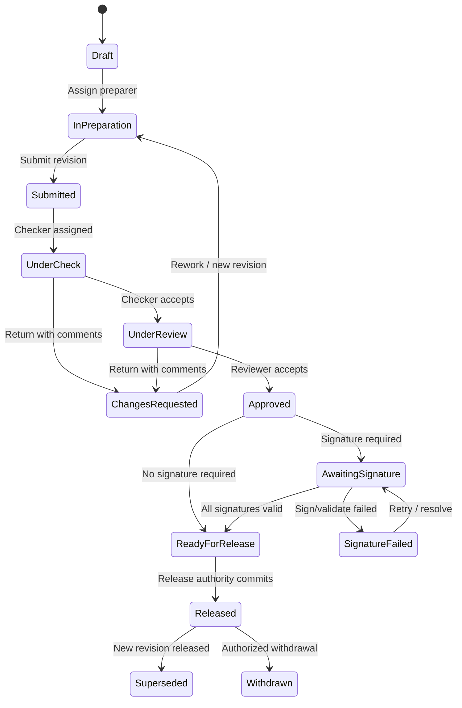

### 6.2 Revision and review binding

- Each edit/save creates or updates a draft revision according to configured editor/save policy.
- Submission creates a reviewable revision snapshot.
- Each review assignment stores the revision ID and content hash.
- Any content change after submission creates a new revision and invalidates or explicitly reopens affected approvals.
- A reviewer can approve, reject or request changes only on the assigned revision.
- Review comments must be linked to document/revision and optionally page/section/paragraph/requirement anchor.
- The history displays who prepared, checked, reviewed, approved, signed and released each revision.

### 6.3 Document status versus workflow status

Keep these concepts separate:

- **Document lifecycle status:** draft, submitted, approved, released, superseded, withdrawn, archived.
- **Workflow instance status:** active, waiting, completed, cancelled, suspended.
- **Review assignment status:** pending, in_review, approved, rejected, changes_requested, reassigned, cancelled.
- **Signature status:** not_required, pending, signed, invalid, failed, revoked/expired where provider can identify it.
- **Release status:** draft, in_validation, ready, released, rejected, withdrawn.

A single `status` column must not attempt to represent all of these concerns.

---

## 7. Cross-Directorate Document Sharing and Release Register

### 7.1 Controlled sharing

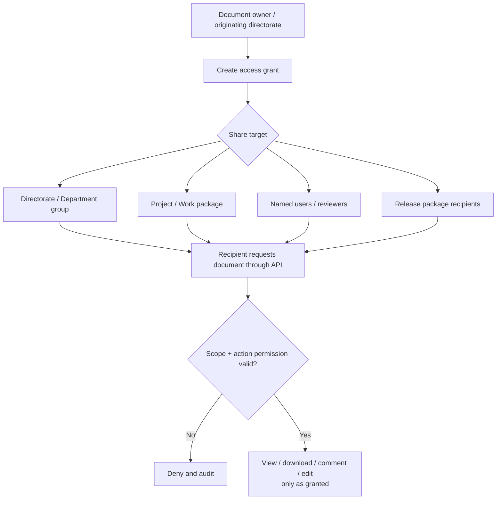

- Share access is explicit, scoped, auditable and revocable.
- A document being linked to another document or a parent does not imply access inheritance unless configured.
- Read, preview, download, edit, comment, review, approve, sign and release are distinct permissions.
- Access grants may have start/end dates.
- Download/view audit logging may be configured by document classification/policy.
- File URLs must be authenticated, short-lived or backend-streamed; never expose public object-store paths.

### 7.2 Central Release Register

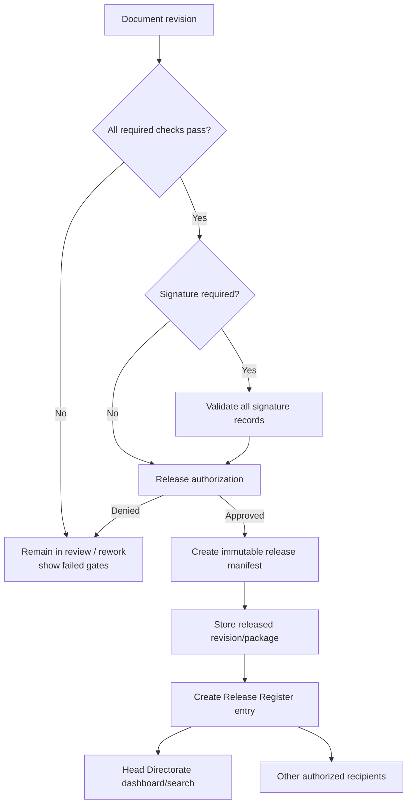

A release entry must identify:

- Release/package ID and release date/time.
- Programme/project and applicable directorates.
- Document IDs and exact revision IDs.
- SHA-256 or approved hash for each file.
- Review/approval evidence.
- Signature records and validation result where required.
- Baseline and source/parent revision references.
- Release authority and release checklist result.
- Any distribution/access grant applied to the package.

### 7.3 Release immutability

- Released files and manifest are immutable.
- Replacing content creates a new revision and new release entry.
- Withdrawal requires authorized action, mandatory reason and audit history.
- Superseding release points to the prior release; old entry remains visible as superseded/withdrawn.
- No hard-delete operation is provided for released content through normal application workflows.
- Central visibility is metadata visibility plus permission-checked document access, not unrestricted access to all files.

---

## 8. Review, Approval and Digital Signature

### 8.1 Default four-step review chain

The default chain requested for release documents is:

1. **Prepared By** — authors/updates the document and submits a specific revision.
2. **Checked By** — performs completeness/technical/checklist review.
3. **Reviewed By** — performs discipline/management/independent review as configured.
4. **Approved By** — provides formal approval for release eligibility.

This is only the baseline. The workflow designer can rename, reorder, add, remove, parallelize or conditionally skip stages according to approved rules.

### 8.2 Review sequence

```mermaid
sequenceDiagram
    participant A as Author / Prepared By
    participant PMS as ADA PMS
    participant C as Checked By
    participant R as Reviewed By
    participant AP as Approved By
    participant SIG as ADA Signature Provider
    participant REL as Release Authority

    A->>PMS: Submit revision Rn
    PMS->>C: Assign check task bound to Rn/hash
    C->>PMS: Accept or request changes
    alt Changes requested
        PMS->>A: Return comments and rework task
        A->>PMS: Submit new revision Rn+1
        PMS->>C: Restart affected review chain
    else Check accepted
        PMS->>R: Assign review task
        R->>PMS: Accept or request changes
        PMS->>AP: Assign approval task
        AP->>PMS: Approve revision Rn/hash
        PMS->>SIG: Request required signatures
        SIG-->>PMS: Signature + validation evidence
        PMS->>REL: Release package ready for final authorization
        REL->>PMS: Authorize release
        PMS-->>A: Released; register entry created
    end
```

### 8.3 Electronic approval versus digital signature

- Approval is a recorded business decision within the workflow.
- A digital signature is a cryptographic operation over the exact document bytes or approved PDF representation.
- A typed name, checkbox, scanned signature image or generated stamp is not, by itself, a cryptographic digital signature.
- The application uses an adapter to the ADA-approved PKI/token/signing service.
- Private keys must remain in the approved hardware/remote signing environment; never store them in PMS database, source code or Docker images.
- Signature validation includes expected document hash, signer identity, certificate and validation data required by ADA policy.
- If the document changes after signing, signature validation must fail or show that the signed revision no longer matches; create a new revision and repeat required review/signature.
- The final signature implementation depends on ADA confirming its certificate authority, signing token/provider, signature profile and revocation-check approach.

### 8.4 Separation of duties

- Enforce maker-checker rules per workflow configuration.
- If required, Prepared By cannot be Checked By, Reviewed By, Approved By or Release Authority for the same revision.
- Reject approvals by inactive users or users whose scoped role has expired.
- Delegation requires explicit grant, scope and effective dates; audit both delegate and original approver.
- System administrator does not inherently have business approval authority.

---

## 9. Programme / Project Planning and Tasks

### 9.1 Planning flow

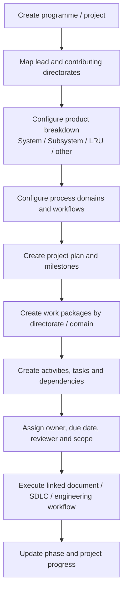

### 9.2 Planning inputs, outputs and integrations

| Area | Behaviour |
|---|---|
| Inputs | Programme/project dates, milestones, directorates, product breakdown, work packages, activities, tasks, dependencies, estimates and owners |
| Process | Define plan → decompose work → assign owners → monitor progress → review/adjust baseline |
| Integrations | Jira sync; CSV/XLSX import/export; MS Project XML where required |
| Outputs | WBS, milestone status, task progress, overdue list, workload, project progress |
| Traceability | Tasks link to documents, requirements, designs, development work, tests, deployments/releases and maintenance records |

### 9.3 Task lifecycle

Retain the ProFlow default as a template; transitions are configurable.

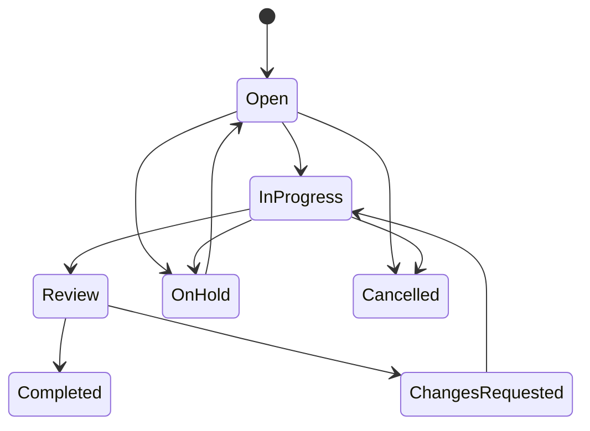

Every transition must be validated server-side. Legacy ProFlow task status updates were not fully transition-validated; the new system must correct this gap.

### 9.4 Task assignment and cross-directorate dependencies

- Tasks belong to a project/work package and may reference a directorate, department and engineering item.
- A task can be assigned to one owner and multiple contributors/reviewers as permitted.
- Cross-directorate dependency edges must identify predecessor/successor and responsible parties.
- Progress must not be changed by client-side percentage alone; define status/progress calculation rules.
- A task cannot be marked complete while configured mandatory deliverables or approvals remain open.

---

## 10. Requirement Management

### 10.1 Requirement lifecycle

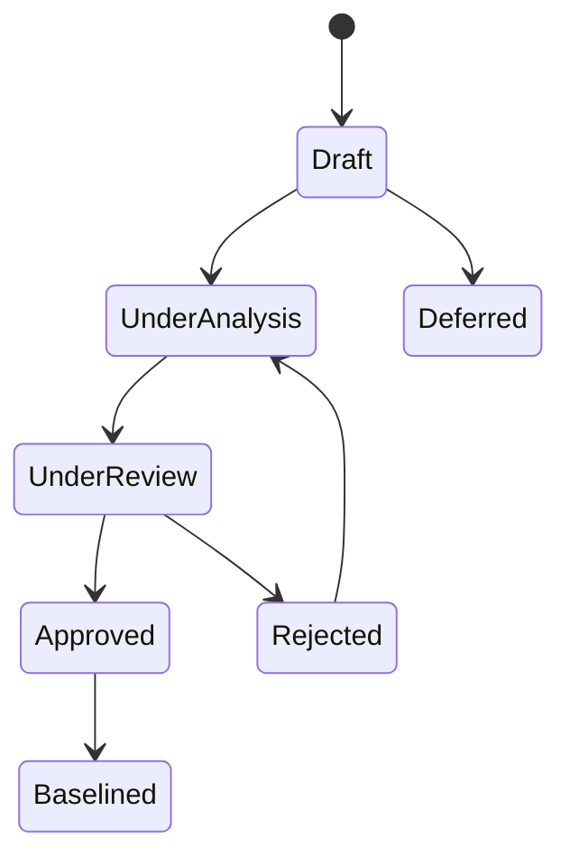

### 10.2 Process

1. Register/upload a BRD, SRS, external requirements export or other configured source.
2. Store source system, external document/version, originating directorate, project and file hash.
3. Capture requirements through in-document tagging, import or structured entry.
4. Generate unique requirement IDs using a configurable prefix/sequence.
5. Validate mandatory fields (title, description, type, priority, acceptance criteria, source and owner as configured).
6. Analyze and link requirement dependencies/relationships.
7. Submit for assigned review and approval.
8. Baseline approved requirements as immutable snapshots.
9. Link requirements to design/engineering artifacts, development tasks, test cases, defects and releases.
10. Support impact analysis when a requirement changes after baseline.

### 10.3 External requirement tool (DOORS) flow

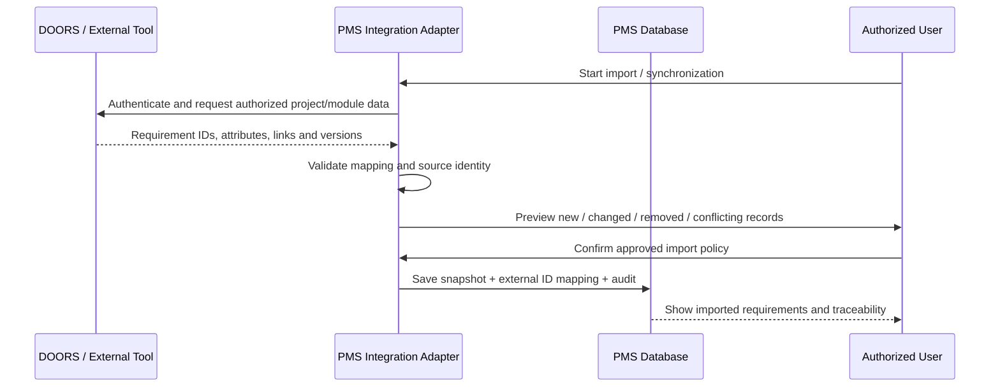

- Use the API supported by the deployed DOORS/DOORS Next version.
- Support file-based exchange (CSV/XLSX/ReqIF) where API integration is unavailable.
- Do not overwrite authoritative source records without a configured synchronization direction and conflict policy.
- Preserve source ID, source version, import timestamp and sync outcome.
- External requirements are visible only to authorized scopes.

### 10.4 Traceability

- Requirement ↔ requirement.
- Requirement → document/revision.
- Requirement → design/engineering artifact.
- Requirement → development task/commit/merge request.
- Requirement → test case/execution/defect.
- Requirement → baseline/release.
- Retain relation type (depends_on, related_to, conflicts_with, implements, derived_from, verifies, etc.) and change history.

---

## 11. Design and Engineering Artefacts

### 11.1 Design workflow

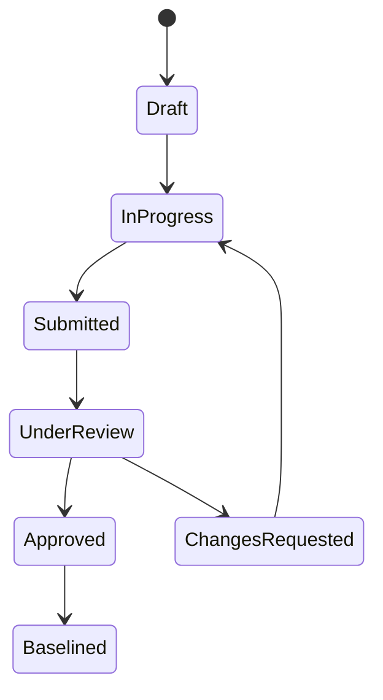

### 11.2 Supported capability

Retain the legacy design module features:

- Design records and configurable widgets.
- Diagram/artifact types such as architecture, workflow, sequence, class, ER, interface and other configured formats.
- draw.io embedded editor and native XML/SVG storage.
- Uploaded files and external links.
- Artifact versioning and controlled restore.
- Review, approval and baseline.
- Requirement links and document section mappings.
- Design document templates and PDF generation.

Extend to engineering-design artifacts as configured by each domain: models, drawings, calculations, interface records, analyses and evidence. Specific artifact types and approval rules must be supplied by ADA.

### 11.3 Diagram editor integration

- Serve draw.io from an intranet host.
- Store native diagram source (XML) and preview (SVG/PDF where generated).
- Validate editor origin and `postMessage` source/origin.
- Save through authenticated API and optimistic concurrency.
- Keep the prior version if save fails.
- Do not depend on public `embed.diagrams.net` runtime availability in air-gapped production.

---

## 12. Software Development Workflow

### 12.1 Development lifecycle

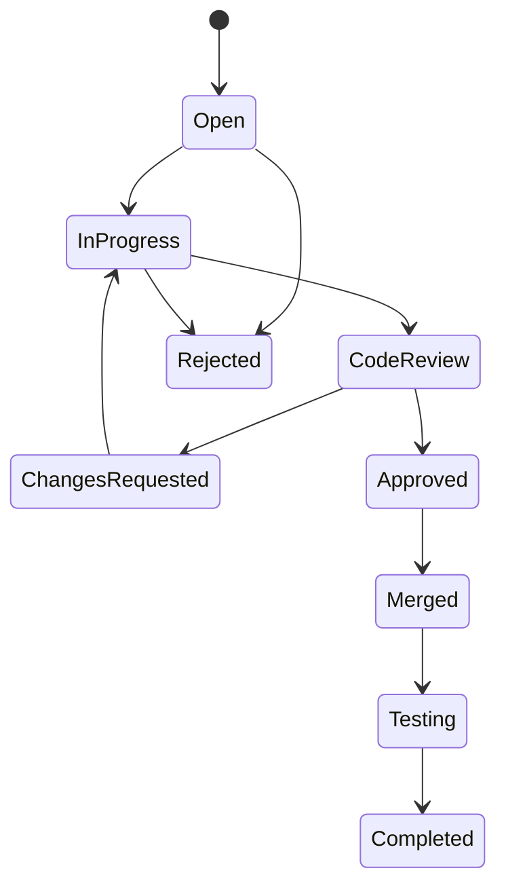

The default stages and action permissions are based on the legacy ProFlow workflow. Administrators can configure transitions and roles by project/domain.

### 12.2 Git workflow

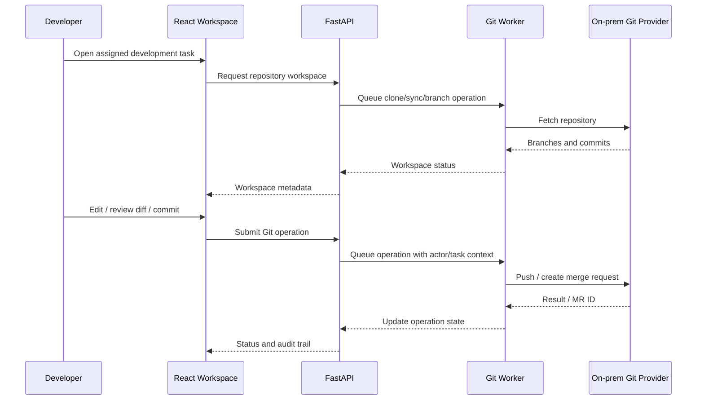

Retain clone, pull, status, diff, branch, commit, push, log, pull/merge request, review/merge, manual reference mode and traceability. Git CLI operations execute in a restricted worker with allowlisted repositories and paths; never execute arbitrary browser-provided shell commands.

### 12.3 Source-control provider support

- GitLab, GitHub Enterprise, Bitbucket and Azure DevOps where deployed.
- IBM Rational ClearCase as a separately designed adapter/reference integration; do not assume branch/merge semantics are identical to Git.
- Repository credentials are held server-side.
- Local work must not be silently discarded on failed sync or conflict.
- Every push/merge request operation links back to the task and audit event.

---

## 13. Testing, Verification and Defects

### 13.1 Test lifecycle

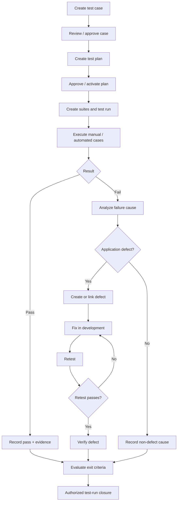

### 13.2 Test plans, suites, runs and cases

- Test case fields: ID, title, objective, preconditions, test type, steps, expected results, requirement/design/dev-task links, owner and review state.
- Test plan: scope, build/version, environments, entry/exit criteria, schedule and approval.
- Test suite: hierarchical grouping and manual case assignment.
- Test run: planned cases, build version, environment, executor, status and exit criteria.
- Test execution: append-only result history, tester, timestamp, actual result, failure cause and evidence.
- Test evidence: file object, checksum, type, size, uploader, time and linked execution.
- Test run closure requires all configured exit criteria and authorized closure.

### 13.3 Failure cause and defect handling

Use the ProFlow rule as the default:

- A failed execution with cause `application_defect` creates a new defect or links an existing open duplicate.
- Other causes (environment, test data, automation script, configuration, infrastructure, expected behaviour changed, equipment/fixture issue) are recorded as analysis outcomes and do not automatically create application defects.
- The failure taxonomy is configurable by domain.
- A fixed defect creates a retest action and resets relevant run-case execution state according to policy.
- A passing retest can automatically move the defect to verified; closure may still require authorized confirmation.
- A failed retest reopens or retains the defect with a new execution link.

### 13.4 Defect lifecycle

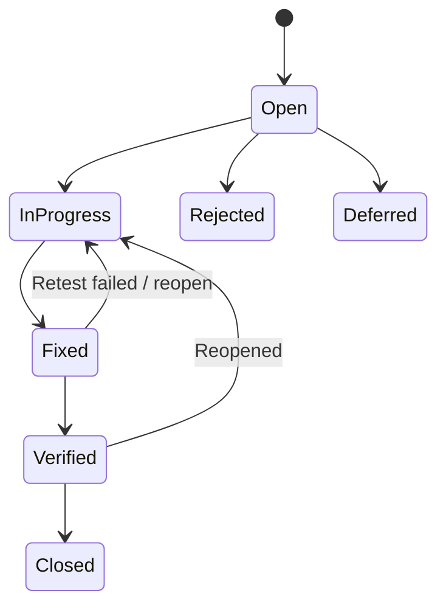

### 13.5 Test automation

- Register approved tools and runner environments.
- Map test cases to automation identifiers.
- Queue execution jobs and return job IDs.
- Worker executes in a controlled runner image; it must not have unrestricted access to the application database or network.
- Results, screenshots, videos, traces and logs are ingested through validated APIs and linked to test executions.
- Job retries must not duplicate executions.
- Tool not installed/unavailable results in a clear failed job, not a false pass.
- Playwright is the initial reference adapter; Selenium/Cypress/Postman/Newman/JMeter/ZAP are optional adapters.

---

## 14. Deployment and Software Release

This workflow concerns software deployment to environments and is distinct from the enterprise document Release Register.

### 14.1 Deployment lifecycle

```mermaid
stateDiagram-v2
    [*] --> Planned
    Planned --> AwaitingApproval : Approval required
    Planned --> Approved : No approval required
    AwaitingApproval --> Approved : Approve
    AwaitingApproval --> Rejected : Reject with reason
    Approved --> Deploying : Validation gate passes
    Deploying --> Deployed : Execution + health checks succeed
    Deploying --> Failed : Script / callback / health check fails
    Failed --> Deploying : Authorized retry
    Deployed --> RolledBack : Rollback creates new operation
    Planned --> Cancelled
    Approved --> Cancelled
```

### 14.2 Validation gates

Before execution, check:

- Correct target project/environment.
- Approved release version/tag/commit.
- Required approval completed.
- Required test plan/run closed and passed.
- No blocking critical defects.
- Required release documents and checklist complete.
- Deployment configuration active and signed/approved where required.
- Credentials available through secret storage.
- Change window and other ADA-defined conditions satisfied.

Failed gates must report the exact missing condition.

### 14.3 Execution

- Queue background job and return job ID.
- Use approved script, internal CI/CD API or deployment adapter.
- Mask secrets in logs.
- Perform post-deployment health checks.
- Store execution start/end, target, version, worker, outcome and logs.
- Retry is a new attempt with history.
- Rollback is a new deployment operation targeting a prior approved version; do not rewrite the original deployment record.
- Require authorization and audit for cancel/retry/rollback.

---

## 15. Hardware / Engineering Process Template

The exact ADA hardware workflow was not provided. The platform must therefore deliver a **configurable engineering process template**, not claim a prescribed aircraft development lifecycle.

### 15.1 Example configurable flow

```mermaid
flowchart TD
    A["Engineering project / work package"]
    A --> B["Register system / subsystem / LRU"]
    B --> C["Capture source requirements and references"]
    C --> D["Prepare engineering documents / design artefacts"]
    D --> E["Technical review / cross-directorate review"]
    E --> F{"Changes required?"}
    F -->|Yes| D
    F -->|No| G["Verification / validation planning"]
    G --> H["Execute configured verification activities"]
    H --> I["Record results, deviations and evidence"]
    I --> J{"Acceptance criteria pass?"}
    J -->|No| K["Corrective action / change request"]
    K --> D
    J -->|Yes| L["Approve controlled baseline"]
    L --> M["Sign (if required) and release document package"]
    M --> N["Central Release Register"]
```

### 15.2 Configurable engineering deliverables

Potential document/artifact categories to be enabled only where ADA approves them:

- System/subsystem/LRU specification.
- Requirement allocation and traceability.
- Interface/control document.
- Architecture/design document.
- Engineering drawing/model.
- Analysis/calculation report.
- Verification plan/procedure/report.
- Validation report.
- Test evidence and deviation/non-conformance record.
- Configuration item/baseline record.
- Change request and impact analysis.
- Review minutes and release note.

### 15.3 Directorate collaboration

- A lead directorate owns the work package or engineering item.
- Contributing directorates receive scoped tasks/document assignments.
- Reviews may be parallel across disciplines or sequential according to workflow configuration.
- Technical concurrence can be a separate decision from managerial approval.
- A parent document may require consolidated responses from all assigned directorates before it advances.
- A directorate's completion is based on its assigned deliverables and approved progress rules, not on the total number of documents alone.

### 15.4 Do not hard-code

Do not code fixed assumptions such as “all hardware documents go through exactly four reviews”, “all LRUs use the same phases”, or “all engineering activities need the same tests”. Encode approved process differences through workflow, metadata, role and gate configuration.

---

## 16. Maintenance and In-Service Change Workflow

Retain the legacy maintenance capability and allow other domains to configure maintenance/change workflows.

```mermaid
stateDiagram-v2
    [*] --> Reported
    Reported --> UnderInvestigation
    UnderInvestigation --> InProgress
    InProgress --> Testing
    Testing --> Resolved
    Resolved --> Verified
    Verified --> Closed
    InProgress --> Deferred
    Deferred --> InProgress
    Closed --> [*]
```

Legacy maintenance types include bug fix, update, performance and adaptation. For engineering domains, ADA may add corrective action, change request, deviation, non-conformance or other categories.

A maintenance/change record should capture:

- Source release / baseline / engineering item.
- Type, severity, priority and impact.
- Root cause and proposed change.
- Impacted requirements, design artefacts, documents, software builds and tests.
- Responsible directorate, department and owner.
- Review/approval route and change authorization.
- Verification evidence and revised release/baseline.
- Closure reason and audit history.

---

## 17. Dashboards, Completion Calculation and Reports

### 17.1 Project-level phase dashboard

For SDLC-enabled projects, show a consistent phase chain:

1. Planning.
2. Requirements.
3. Design.
4. Development.
5. Testing.
6. Deployment / Release.
7. Maintenance.

The dashboard must show phase-level completion and overall project completion. For hardware/other domains, use the equivalent configured workflow phases; do not force SDLC phase labels onto those work packages.

### 17.2 Example dashboard

```mermaid
flowchart LR
    P["Project / Programme"]
    P --> PL["Planning"]
    PL --> REQ["Requirements"]
    REQ --> DES["Design"]
    DES --> DEV["Development"]
    DEV --> TST["Testing"]
    TST --> DEP["Deployment / Release"]
    DEP --> MNT["Maintenance"]
    PL -.-> DOC["Controlled documents<br/>and release gates at each phase"]
    REQ -.-> DOC
    DES -.-> DOC
    DEV -.-> DOC
    TST -.-> DOC
    DEP -.-> DOC
    MNT -.-> DOC
```

Every phase can have deliverables and release documents. A phase is not complete solely because its tasks show 100%; all mandatory workflow gates, documents, approvals, signatures and exit criteria must be satisfied.

### 17.3 Completion calculation rules

- Each project/work package workflow defines phase weights or progress calculation strategy.
- For task-weighted progress, store a configured weight and completion value for each work item.
- For gate-based phases, completion must consider mandatory deliverables and decisions.
- Do not calculate all projects by averaging status percentages blindly.
- Define roll-up for project → directorate → department → engineering item → work package and allow parent roll-up rules.
- Display completed/total counts, weighted progress, blockers and overdue items so users can explain the percentage.
- Preserve the calculation version/rules used for historical reports.

Illustrative calculation only:

\[
\text{Phase Progress} =
\frac{\sum_i(\text{work item weight}_i \times \text{approved completion fraction}_i)}
{\sum_i \text{work item weight}_i}
\times 100
\]

If a mandatory release gate remains open, display a separate gate status and do not present the phase as fully complete even if its weighted work progress is 100%.

### 17.4 Drill-down path

Head Directorate → Programme → Project → Directorate → Department → System → Subsystem → LRU → Work Package → Phase → Document/Task.

The path is permission-filtered at every level. Hide inaccessible labels/counts if their existence itself is sensitive under ADA policy.

### 17.5 Reports

All official reports must be generated as PDF and previewable in the application. Examples:

- Programme/project status and milestone report.
- Directorate-wise and department-wise progress.
- Project phase completion and release readiness.
- Document register and revision history.
- Review/approval aging and pending decision report.
- Release package index / release transmittal.
- Requirement Traceability Matrix (RTM).
- Requirement/design/development/testing/defect traceability.
- Design/engineering document status.
- Test plan/run/STR/defect report.
- Deployment history, failure, retry and rollback report.
- Maintenance/change report.
- Baseline and impact analysis.
- Workflow SLA and process compliance.
- Audit/security event report.

Report metadata includes generated time, filters, scope, data cut-off, template version, creator and classification label if configured. PDF rendering uses server-side templates and locally packaged fonts.

---

## 18. Notifications, SLA and Escalations

### 18.1 Notification events

| Event | Typical recipient |
|---|---|
| Document/task assigned | Assignee |
| Document submitted | Configured checker/reviewer |
| Review due / overdue | Reviewer and configured manager |
| Changes requested | Prepared-by / owner |
| Review approved/rejected | Document owner and next stage |
| Signature requested | Signatory |
| Signature failed/invalid | Owner, process admin and authorized support |
| Release ready | Release authority |
| Document released | Originating and authorized recipient groups |
| Child deliverable overdue | Child owner and parent coordinator |
| Milestone at risk | Project manager/directorate lead |
| Integration or background job failed | Initiator and support role |
| Permission/share changed | Owner and affected administrator where configured |

### 18.2 SLA behaviour

- SLA uses configured working calendar/timezone and holiday schedule.
- Support reminder-before-due, due-date reminder and overdue escalation.
- Escalation target, interval, maximum retries and reassignment are configurable.
- A user may receive in-app notification even when email is unavailable.
- Notifications are deduplicated by event/entity/recipient/action key.
- Delivery failures are logged and retried with bounded backoff.
- Do not let a failed email block a valid business transition if in-app audit/notification persistence succeeded.

### 18.3 Notification state

Use independent delivery records for in-app, email and other channels. The read/unread state of an in-app notification is separate from email delivery status.

---

## 19. Traceability, Baselines and Configuration Control

### 19.1 End-to-end traceability model

```mermaid
flowchart TD
    SRC["Head Directorate source document / requirement"]
    SRC --> CHILD["Derived directorate / department documents"]
    CHILD --> WP["Work packages / tasks"]
    WP --> REQ["Requirements"]
    REQ --> DES["Design / engineering artefacts"]
    DES --> DEV["Development / engineering execution"]
    DEV --> TEST["Verification / test cases and evidence"]
    TEST --> DEF["Defects / deviations / corrective actions"]
    DEF --> CHANGE["Change request / rework"]
    CHANGE --> REQ
    TEST --> BASE["Approved baseline"]
    BASE --> REL["Signed release package"]
    REL --> REG["Central Release Register"]
    REG --> MNT["Maintenance / change records"]
```

The chain may differ for hardware, software and other configured domains; the common relationship and audit framework must allow variation without losing provenance.

### 19.2 Baseline behaviour

- A baseline is an immutable snapshot of selected entities and document revisions at a defined time.
- Baseline records include baseline identifier, scope, owner, creation reason, approval, item list, revision IDs and hashes.
- Changes after baseline create new revisions/change events; never mutate the baseline snapshot.
- Baseline comparison identifies added, changed, removed, superseded and impacted records.
- Release package may reference one or more approved baselines.
- Re-baseline requires authority and full traceability.

### 19.3 Change impact analysis

A change to a parent document, requirement, design, engineering item or configuration item should identify linked/derived entities:

- Child documents.
- Allocated requirements.
- Design and interface artifacts.
- Tasks and work packages.
- Test cases, test runs and evidence.
- Defects/deviations.
- Release packages and released baselines.

Impact analysis creates review tasks; it does not automatically alter or invalidate related entities without an authorized decision.

---

## 20. Integration Workflows

### 20.1 Integration catalogue

| Integration | Process | Required behaviour |
|---|---|---|
| OnlyOffice | Document create/edit/save | Intranet-hosted editing, authenticated callback, version-safe save and editor session audit |
| PDF viewer | Preview reports/releases | Local viewer; backend authorizes each file request |
| draw.io | Design/engineering diagrams | Local hosting, origin validation, native source and version history |
| DOORS / DOORS Next | Requirements capture/synchronization | Version-aware adapter or validated import/export; external ID mapping |
| GitLab/GitHub/Bitbucket/Azure | Software development | Server-side token storage, Git worker, MR/PR, commit traceability |
| ClearCase | Legacy source/configuration management | Dedicated adapter/reference approach; avoid assuming Git operations |
| Jira | Task issue synchronization | Field/status mapping, idempotency, conflict report |
| Playwright/Selenium/Cypress | Software testing | Isolated runner, queued job, execution evidence |
| Postman/JMeter/ZAP | API/performance/security testing | Adapter registry and worker isolation |
| CI/CD and deployment | Software deployment | Internal API/script, validated webhook, masked logs, retry/rollback |
| PKI/signature | Document signing | Approved provider, revision hash binding and validation |
| LDAP/AD/SSO | Authentication | Internal identity endpoint, secure service account |
| SMTP/internal messaging | Notification | Internal relay only; in-app notification remains available |

### 20.2 Common integration job sequence

```mermaid
sequenceDiagram
    participant U as User
    participant API as FastAPI
    participant DB as PostgreSQL
    participant Q as Job Queue
    participant W as Worker
    participant X as Internal Tool

    U->>API: Start integration action
    API->>API: Validate scope, permission and request
    API->>DB: Create job + audit event + idempotency key
    API->>Q: Enqueue job ID
    API-->>U: Accepted + job ID
    Q->>W: Deliver job
    W->>DB: Claim job with lease / attempt record
    W->>X: Execute authorized operation
    X-->>W: Response / error
    W->>DB: Persist result, sync mapping and audit
    U->>API: Poll / receive progress
    API-->>U: Current job state and safe result
```

- Use bounded retries with backoff and job lease recovery.
- Persist failure reason and safe diagnostics.
- Do not retry non-idempotent actions without an idempotency strategy.
- Never mark workflow step complete just because a job was accepted; wait for successful completion and required validation.
- Integration adapters must not bypass role checks, workflow state rules or audit events.

---

## 21. Audit, Security and Failure Behaviour

### 21.1 Mandatory audit events

At minimum:

- Login success/failure, lockout, logout and session expiry.
- User, role, organization, project and permission changes.
- Document create, upload, edit, download/view where required, revision, relation, share and access revocation.
- Workflow definition create/change/validate/publish/retire.
- Workflow assignment and each transition.
- Review comment, decision, delegation and exception.
- Signature request, signature result, validation and failure.
- Baseline creation/comparison and release/withdraw/supersede.
- Report generation/export.
- Integration configuration, sync, job attempt and callback.
- Administrative security and system configuration changes.

Audit record should include actor, role/scope, action, entity, revision, UTC timestamp, source/correlation ID, before/after state or protected diff, reason and outcome. Protect audit from normal update/delete operations.

### 21.2 Security enforcement

- Backend checks access on every request, including search, preview, download, editor callbacks, report generation and release-register file access.
- Deny by default; do not infer visibility from a React menu.
- Validate file content and quarantine suspicious uploads.
- Never put secrets in browser code, logs or public configuration.
- Protect callbacks using signed tokens/JWT or mutual authentication as supported by each tool.
- Disable unnecessary outbound network access and telemetry.
- Keep document files outside public static directories.
- Use separate identities and least-privilege access for API, workers, database and integrations.
- Enforce workflow maker-checker and signatory role requirements server-side.

### 21.3 Failure and recovery matrix

| Failure | Expected behaviour |
|---|---|
| LDAP/SSO unavailable | Show controlled authentication failure or approved fallback process; never bypass login |
| User lacks scope | Deny; do not reveal protected document contents |
| OnlyOffice unavailable | Keep document metadata/history available; prevent false save success; allow configured alternate/manual path |
| Editor save callback invalid | Reject callback, preserve existing revision and audit safely |
| draw.io unavailable | Retain existing diagram and versions; show integration state |
| DOORS/Jira/Git tool unavailable | Mark sync/job failed or pending; retain source data; offer authorized retry |
| Git conflict | Preserve local changes and explain resolution; never discard workspace silently |
| Test runner unavailable | Mark job failed; never mark tests passed |
| Deployment script/health check fails | Mark failed with safe logs; allow authorized retry/rollback |
| Signature provider unavailable | Keep revision approved-but-not-signed; do not release if signature required |
| Signature validation fails | Block release and create audit/security event |
| PDF generation fails | Keep report request failed with diagnostic; source data unchanged |
| Database temporarily unavailable | Fail safely; do not acknowledge uncommitted transition |
| Worker stops mid-job | Lease expires/recovery marks job retryable or failed; idempotency prevents duplicate side effects |
| Storage unavailable | Block upload/release; do not create metadata that claims a file is safely stored |
| Release manifest mismatch | Block registration and flag integrity error |
| Notification channel fails | Keep in-app event; retry non-primary delivery with bounded policy |

### 21.4 Completion and immutability

- Approved review records, signatures, baseline snapshots, released files, test execution history and audit events are retained according to policy.
- Corrections create new events/revisions, not destructive edits to history.
- A workflow can be reopened only through configured, authorized and audited action.
- A deployment rollback is a new deployment operation.
- A withdrawn release remains discoverable in history with access governed by policy.

---

## 22. Configuration Examples

Examples below are illustrative configuration intent, not a fixed schema or a command to hard-code these values. The actual database/API model should be versioned and validated.

### 22.1 Example workflow routing matrix

| Condition | Workflow template | Review sequence | Release rule |
|---|---|---|---|
| Domain = Software; document type = SRS | Software Requirements Review | Prepared By → Requirements Reviewer → Approved By | Baseline required; signature as configured |
| Domain = Software; document type = STR | Software Test Report Review | Prepared By → Test Lead → Quality Reviewer → Approved By | Test run exit criteria must pass |
| Domain = Hardware; document type = Engineering Specification | Engineering Document Review | Prepared By → Technical Checker → Discipline Reviewer(s) → Approved By | Required technical concurrence and signatures |
| Domain = Hybrid; shared interface document | Cross-Directorate Review | Prepared By → Parallel Directorate Reviewers → Technical Authority → Approved By | All mandatory directorate decisions complete |
| Any domain; release package | Controlled Release | Package Owner → Release Checker → Release Authority | All included revisions approved; manifest valid |

### 22.2 Illustrative workflow definition

```yaml
workflow:
  code: ENGINEERING_SPEC_REVIEW
  version: 1
  domain: hardware
  applies_to:
    document_types:
      - ENGINEERING_SPECIFICATION
  stages:
    - code: prepared
      role: DOCUMENT_PREPARER
      actions: [submit]
    - code: checked
      role: TECHNICAL_CHECKER
      actions: [accept, request_changes]
      separation_of_duties: true
    - code: reviewed
      role: DISCIPLINE_REVIEWER
      approval_mode: all_must_approve
      actions: [approve, request_changes]
    - code: approved
      role: APPROVING_AUTHORITY
      actions: [approve, reject]
      separation_of_duties: true
  signature:
    required: true
    provider: ADA_CONFIGURED_PROVIDER
  release:
    required: true
    authority_role: RELEASE_AUTHORITY
```

The runtime must validate this structure before publication. `ADA_CONFIGURED_PROVIDER` is a placeholder, not an actual provider implementation.

### 22.3 Illustrative parent-child assignment

```yaml
work_package:
  project: AMCA
  process_domain: hybrid
  engineering_item:
    hierarchy: [SYSTEM, SUBSYSTEM, LRU, ECFM]
  lead_directorate: DIRECTORATE_A
  contributing_directorates:
    - DIRECTORATE_B
    - DIRECTORATE_C
  deliverables:
    - document_type: SOFTWARE_REQUIREMENTS_SPECIFICATION
      workflow: SOFTWARE_REQUIREMENTS_REVIEW
      owner_directorate: DIRECTORATE_A
    - document_type: ENGINEERING_SPECIFICATION
      workflow: ENGINEERING_SPEC_REVIEW
      owner_directorate: DIRECTORATE_B
    - document_type: INTERFACE_DOCUMENT
      workflow: CROSS_DIRECTORATE_REVIEW
      owner_directorate: DIRECTORATE_A
```

Project, directorate and document codes above are illustrative. Use actual ADA master data.

---

## 23. Acceptance Scenarios

The following scenarios must be automated as integration/e2e tests where practical.

### Scenario A — User belongs to multiple directorates

- User has an active role in Directorate A and read-only scope in Directorate B.
- User can switch between permitted scopes.
- User cannot access Directorate C documents by URL/API manipulation.
- Audit shows effective scope for sensitive actions.

### Scenario B — Top-level document decomposition

- Authorized Head Directorate user registers a programme-level document.
- User creates second-level documents and assigns them to different directorates.
- Each child has its own owner, workflow, revision and due date.
- Parent view shows child progress and overdue state.
- A user from one directorate cannot edit another directorate's child without an explicit grant.

### Scenario C — Software versus hardware routing

- A software work package exposes the configured SDLC modules.
- A hardware work package exposes the configured engineering workflow.
- A hybrid package creates linked workflows where required.
- Changing a process template requires authorization and a new published version; existing instances stay pinned.

### Scenario D — Four-stage document review

- Prepared By submits revision R1.
- Checked By accepts R1.
- Reviewed By requests changes.
- R1 is retained; preparer creates R2.
- Required reviews re-run against R2.
- Approval of R1 cannot be reused for R2 unless policy explicitly defines a controlled carry-forward rule.

### Scenario E — Signature and release

- Approved revision R2 is sent to the ADA-configured signing provider.
- PMS validates signer certificate and expected file hash.
- A changed file must fail hash validation.
- Release is blocked while signature is pending/invalid.
- Successful release produces a manifest and central Release Register entry.

### Scenario F — Head Directorate release access

- Head Directorate user can search released documents for permitted programmes/directorates.
- User can open/download only documents for which the release scope grants access.
- Restricted child documents remain inaccessible.
- Withdrawal/supersession leaves history and is visible according to policy.

### Scenario G — Dashboard completion

- Project includes planning, requirements, design, development, testing, deployment/release and maintenance.
- Each phase has weighted work items and mandatory document gates.
- Dashboard shows weighted progress and gate status separately.
- A phase with 100% task progress but an incomplete mandatory approval is not marked fully released/completed.

### Scenario H — Legacy SDLC parity

- Create requirement, baseline it, link design, create development task, record Git commit/PR, approve test case, execute test, create defect, fix and retest, close run, approve deployment and record maintenance.
- Confirm all retained ProFlow feature relationships and audit events.
- Confirm server-side transitions and scoped authorization prevent the legacy gaps described in the original documentation.

### Scenario I — Offline runtime

- Deploy the approved image/dependency bundle to a clean target server.
- Disable outbound internet.
- Verify login, dashboards, document upload/edit/save/preview, diagram editing, PDF generation/viewing, notifications, workflows and release register.
- Verify the app makes no public CDN, package registry, telemetry or hosted editor calls.

### Scenario J — Integration failure

- Stop an integration or worker.
- The job must show failed/pending with actionable safe detail.
- No workflow transition may falsely complete.
- Retry must be idempotent and preserve data.
- In-app notification and audit history remain available.

---

## 24. Implementation Sequence and Test Checklist

### Phase 1 — Foundation

- Organization hierarchy and employee memberships.
- Project/programme and engineering-item structures.
- Scoped RBAC/ABAC authorization.
- Authentication and session controls.
- Audit events and notification foundation.
- Dashboard context resolution.

**Gate:** automated tests prove user isolation across directorates, departments, projects, documents and engineering items.

### Phase 2 — Workflow engine and document register

- Workflow definition, validation, versioning and publication.
- Workflow instances, state transitions, assignments and SLA.
- Document identity, types, metadata, revision and file storage.
- Parent/child/derived relationships and controlled sharing.
- Four-stage review chain, maker-checker and comments.

**Gate:** workflows can be configured without source-code edits; every action is validated and audited.

### Phase 3 — Approval, signature and release register

- Signature-provider adapter and ADA-approved provider integration.
- Signature validation and hash binding.
- Release packages, manifests, release authority and central register.
- Head Directorate search/drill-down with permission checks.
- Withdraw/supersede controls.

**Gate:** cannot release incomplete, unsigned-when-required, altered or unauthorized revisions.

### Phase 4 — Planning, dashboard and SDLC

- Project planning, tasks, milestones and directorate contributions.
- SDLC modules and full traceability.
- Completion calculation and roll-up rules.
- Existing ProFlow feature parity and migration mapping.

**Gate:** end-to-end SDLC test and PDF progress/RTM reports pass.

### Phase 5 — Engineering domain and integrations

- ADA-approved hardware/engineering workflow templates.
- DOORS, OnlyOffice, draw.io, Git/ClearCase, Jira, testing, CI/CD and PKI adapters.
- Controlled import/export and integration monitoring.

**Gate:** representative cross-directorate workflows operate with external tools disconnected/reconnected and failures handled safely.

### Phase 6 — Security, performance and offline delivery

- Security review and penetration testing.
- Load/concurrency testing.
- Backup/restore and audit integrity checks.
- Docker hardening and network segmentation.
- Offline images, Python wheels, frontend assets, fonts, templates and licences.
- Clean air-gap installation and acceptance.

**Gate:** full application functionality works without outbound internet; all critical acceptance scenarios pass.

### 24.1 Developer checklist for each workflow feature

- [ ] Workflow version and scope are explicit.
- [ ] Backend transition guard is implemented.
- [ ] Authorization is checked at action and data scope.
- [ ] Revision ID/hash is bound to review and approval.
- [ ] Required fields/checklists and separation of duties are enforced.
- [ ] Rejection/change-request comments are mandatory where configured.
- [ ] Audit event is committed with the business transaction.
- [ ] Notifications and SLA events are created idempotently.
- [ ] Signature/release gates are enforced where configured.
- [ ] Tests cover both authorized and unauthorized actions.
- [ ] Failure/retry behaviour preserves the original data and history.
- [ ] Dashboard/report roll-up reflects the configured workflow.
- [ ] No external internet dependency is introduced.

---

> **Maintenance rule:** Update this document whenever a workflow, approval gate, role mapping, document taxonomy, integration or ADA process decision changes. Keep diagrams and configuration examples synchronized with `ADA_PMS_PROJECT_CONTEXT.md`.

---

## 25. ADA-ELM implementation notes (added 2026-11-03, session 1)

**Runtime (Docker Compose):** `web` (nginx serving the Mantine SPA, proxies `/api`) → `backend` (FastAPI) → `db` (PostgreSQL 16, internal network) · `worker` (SLA sweeps) · OnlyOffice (the existing intranet Document Server, or the optional `onlyoffice` profile).

**Document review flow as implemented:**
1. Author creates the document from a type (number generated from the pattern; template stamped with number, title, project, item and the approval table) or uploads a file.
2. Author edits in OnlyOffice; every save becomes a new iteration (SHA-256).
3. *Submit*: the system resolves the workflow binding and shows the stage plan with **eligible candidates per stage** (role holders in the document's scope). The author picks people; SoD is pre-checked.
4. Each stage creates tasks bound to the iteration hash. Modes are all / any / quorum, checklists gate approval, and a reason is mandatory to return or reject.
5. *Request changes*: the cycle ends, the revision unlocks, the author updates, and resubmitting starts cycle N+1.
6. Signature stage: every actor of the configured stages signs (password re-entry); the cryptographic signature covers the hash.
7. *Release* (Release Authority, not the author or owner): gate checks run, then an immutable register entry is created and the previous release is superseded. Packages get a sealed manifest.
8. *Revise* starts revision B from the released content.

**Smart-workflow UX:** action inbox grouped by urgency, j/k keyboard navigation, live preview next to the decision panel, lifecycle tracker on every document, Ctrl+K global search, delegation for absence, notifications with deep links, and a visual workflow designer for process owners.

**Planning and tasks as implemented (§9, added 2026-11-04, session 3):**

- Structure: Project → Plan (one ACTIVE per project) → Work package (lead and contributing directorates, domain, engineering item) → Activity (phase, owner, dates, hours) → Task and sub-tasks. Milestones and sealed baselines belong to the plan.
- Phases are configurable. A project with its own phases uses only those; otherwise it uses the shared template, so hardware work is not forced onto SDLC labels (§17.1).
- Task lifecycle: the §9.3 template is the default and is configured at `/admin/task-lifecycle`, globally or per project through the API. Every move goes through `POST /work-items/{id}/transition`, which checks that the move exists, who may make it, any required reason, and the gates.
- Gates (§9.4): sub-tasks closed, mandatory checklist, mandatory deliverable documents at their real status, dependencies (FS, SS, FF, SF with lag). Loops are rejected. A named reviewer means the owner cannot accept their own task.
- Progress (§9.4, §17.3): status decides. Open 0, Completed 100, otherwise the assignee's estimate capped at 95. Parents, activities, phases and the project roll up by weight, and the overview shows counts and open gates beside each figure. Full progress with an open gate is not reported as complete (scenario G).
- Scope: plan and task reads are limited to projects the user can see. Changes need `plan.manage` or `task.manage` in the project, directorate or item scope.
- Not yet implemented from §9.2: XLSX and MS Project XML exchange, Jira sync (tool integrations are on hold), and task links to requirements, designs and tests, which arrive with those sections.

**Requirements as implemented (§10, added 2026-11-05, session 3):**

- Source → requirement (ID from the source's configurable prefix, hierarchy through a parent) → review → approval → baseline. Mandatory fields before review are configurable.
- Lifecycle is the §10.1 template plus the moves it implies: withdraw from review, and a return to analysis when approved or baselined content changes. Configurable through the API; no screen yet.
- Review binds to revision and SHA-256. Reviewers decide before approvers, owners and submitters cannot take part, and a new cycle never reuses earlier decisions (scenario D).
- Baselines are sealed text snapshots that later changes cannot alter (§19.2). Impact analysis reports and creates a review task; it changes nothing itself (§19.3).
- Links: depends_on, derived_from, implements, related_to, conflicts_with, with dependency loops rejected. Traceability currently reaches tasks, documents and baselines; design, development, tests and defects join with §11–§13.
- §10.3 external tools: file exchange by CSV with preview and external ID mapping. Approved records are never overwritten. ReqIF and live DOORS are not implemented (tool integrations are on hold).
