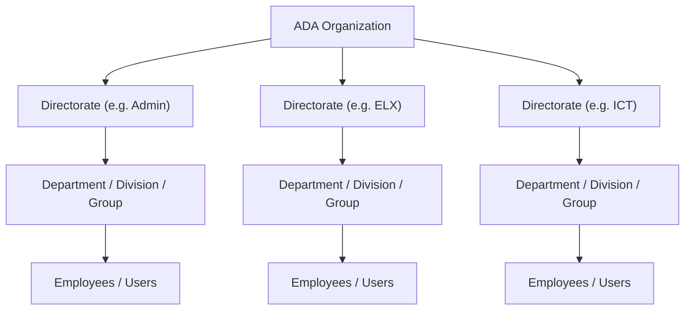
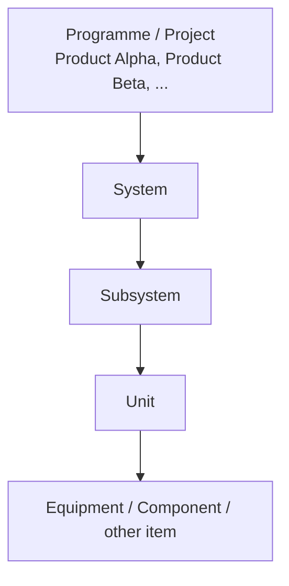
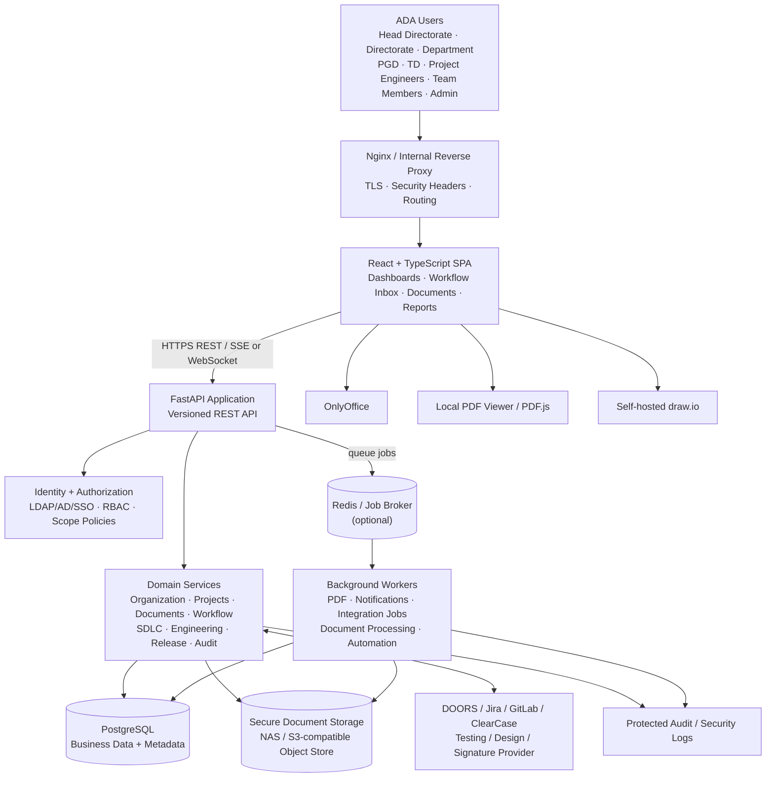
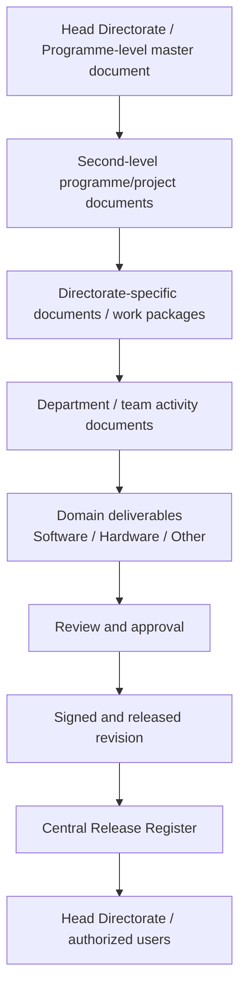

# ADA PMS — Project Context and Implementation Specification

> **Document purpose:** Master context and target-state specification for AI coding agents implementing the ADA Process Management System (PMS).
>
> **Version:** 2.0 target architecture  
> **Status:** Proposed implementation baseline — not yet verified as implemented  
> **Organization:** Aeronautical Development Agency (ADA)  
> **Legacy reference:** ProFlow v2.0 (PHP Yii2 + MySQL)  
> **Target deployment:** On-premises Docker environment on an isolated intranet  
> **Timezone:** `Asia/Kolkata` (store timestamps consistently; render in the user's configured timezone)

---

## 0. How to Use This Document

This document supersedes the legacy technology and deployment assumptions in the ProFlow context while preserving its business capabilities.

1. **Target-state requirements in this document take precedence** for all new React/Python development.
2. **Existing ProFlow features listed in §8 are the functional baseline to retain**, unless an ADA-specific workflow configuration deliberately changes their sequence or applicability.
3. The old Yii2/PHP and Node.js implementation is a reference for understanding legacy behaviour only. Do not copy its framework, session model, database schema, route structure, hard-coded roles, CDN assumptions, or security limitations into the new implementation.
4. Workflow examples are templates, not fixed hard-coded processes. ADA administrators must be able to configure, publish, version, and assign workflows without a source-code change.
5. Distinguish implemented functionality from planned functionality in code comments, status reports, README files, and generated documentation. Do not claim a feature is complete merely because it is specified here.
6. Where ADA policy, directorate names, role definitions, signature standards, data-classification rules, or retention periods are not supplied, implement configuration points and mark the operational value as **TBD by ADA**. Do not invent policy.

### 0.1 Related document

`ADA_PMS_ARCHITECTURE_WORKFLOWS.md` defines end-to-end and module-wise process diagrams, configurable workflow behaviour, release controls, and acceptance scenarios. Keep both documents synchronized.

---

## 1. Product Overview

| Attribute | Target value |
|---|---|
| Product name | ADA PMS (working name; retain configurable product branding) |
| Product type | Enterprise Process, Project, Engineering Document and Lifecycle Management System |
| Primary organization | Aeronautical Development Agency (ADA) |
| Primary purpose | Manage projects, directorates, departments, engineering entities, documents, reviews, approvals, releases, tasks, and lifecycle processes with end-to-end traceability |
| Legacy product | ProFlow v2.0 — existing SDLC process-management application |
| Frontend | React + TypeScript |
| Backend | Python + FastAPI |
| Database | PostgreSQL recommended; SQL Server portability is a design requirement |
| File/document storage | Secured on-premises file/object storage; database stores metadata and content hashes |
| Runtime | Docker / Docker Compose initially; deployment must support an ADA-approved on-premises container platform |
| Network | Intranet / air-gapped runtime; no mandatory public internet access |
| API | Versioned REST API; OpenAPI specification generated from FastAPI |
| Authentication | ADA-approved identity provider (LDAP/Active Directory/SSO where available) plus controlled local-admin fallback |
| Authorization | RBAC + organization/project/document attributes (ABAC-style scope checks) |
| Primary language | English initially; UI labels should be externalized for later localization |
| Time handling | UTC in persistence, `Asia/Kolkata` display by default |
| Security posture | Least privilege, deny by default, auditable approvals, protected document handling, secure offline operations |

### 1.1 Main product objectives

- Provide one common process platform for multiple ADA directorates and departments.
- Manage multiple projects such as **Product Alpha**, **Product Beta**, and other programmes without hard-coding project names.
- Support engineering product structures such as **Project → Unit → Component**, while allowing additional or different hierarchy levels (for example System and Subsystem).
- Map employees to directorates, departments, projects, systems, subsystems, units, and roles as authorized.
- Navigate users to a dashboard based on their organization scope, assignments, responsibilities, and permissions.
- Enable the SDLC process for software-related work and separate configurable engineering/process flows for hardware and other work domains.
- Manage documents from Head Directorate level through directorate and department work products, including parent/child and derived-document relationships.
- Provide one controlled release repository / release register so Head Directorate users can discover and review released documents they are authorized to see.
- Make review stages, approver roles, document formats, release rules, and workflow sequences configurable.
- Preserve the existing ProFlow SDLC capabilities and extend them for multi-directorate programme execution.
- Provide secure integrations for document editing, requirements, design, source control, testing, and reporting tools.
- Provide process notifications, escalation, immutable audit history, and project-level progress visibility.
- Support intranet-only deployment with every required dependency packaged and verified before transfer to the isolated environment.

### 1.2 Non-goals unless separately approved

- Replacing the organization's existing engineering authoring tools.
- Replacing an enterprise requirements-management or PLM tool where ADA teams already use one; PMS should integrate, reference, or import controlled data.
- Performing automatic remote cloud synchronization in the isolated runtime.
- Treating a workflow status change as a substitute for a formal document approval or cryptographic digital signature.
- Assuming that every directorate uses SDLC.
- Assuming all users in a directorate can see all directorate documents.
- Treating an uploaded image of a signature as a cryptographic digital signature.

---

## 2. Business Organization and Domain Model

The system must represent two related but distinct structures:

1. **Organization structure:** ADA → Directorate → Department/Division/Group → Employee.
2. **Programme/product structure:** Programme/Project → System → Subsystem → Unit → Equipment/Component/Artifact.

The two structures are connected through project participation and responsibility assignments. Do not force a single hierarchy to represent both.

### 2.1 Organization hierarchy



Directorate and department names are **master data**, not enum values in code. The names above are examples from the supplied requirement. ADA administrators must be able to add, rename, deactivate, and reorganize organizational units while preserving historical references.

### 2.2 Programme and engineering hierarchy



- The supplied example **Product Alpha → Unit → Component** must be representable.
- Some projects may have System and Subsystem levels; others may use a different breakdown.
- The product breakdown must therefore be configurable by project/programme (hierarchy type and allowed levels).
- An engineering item may have its own owner directorate, contributing directorates, technical authority, responsible department, and document set.
- Do not assume that every Unit belongs to only one directorate. Support a lead owner plus multiple contributing organizations where approved.

### 2.3 Organization-to-project mapping

A user can belong to one or more directorates/departments and can be assigned to multiple projects or engineering items. Model assignments explicitly rather than storing one `directorate_id` or `project_id` directly on the user as the only relationship.

Minimum relationships:

- `users` ↔ `organizational_units` through `user_org_assignments`.
- `projects` ↔ `organizational_units` through `project_directorate_assignments`.
- `engineering_items` ↔ `organizational_units` through ownership/contributor assignments.
- `users` ↔ `projects` through `project_memberships`.
- `users` ↔ `engineering_items` through responsibility assignments when required.
- Role assignments must include a scope (global, directorate, department, project, engineering item, document, or workflow instance).
- Membership changes must not rewrite historical approvals or audit records.

### 2.4 Core business entities

| Entity | Purpose |
|---|---|
| Organization | ADA organization root / tenant boundary if a future multi-organization mode is approved |
| Organizational Unit | Directorate, department, division, or group; parent-child hierarchy |
| User / Employee | Authenticated identity and employee profile |
| Role / Permission | Business role and action permission |
| Role Assignment | Role granted to a user or group within a defined scope and validity period |
| Programme / Project | Product Alpha, Product Beta, and other project/programme records |
| Product Breakdown / Engineering Item | System, subsystem, Unit, Component, equipment, component, or configured level |
| Project Directorate Assignment | Lead and contributing directorates for a project |
| Process Domain | Software, hardware, systems engineering, administration, or an ADA-configured domain |
| Workflow Definition | Configurable process template, versioned and published |
| Workflow Instance | A workflow run bound to a project, document, work package, or engineering item |
| Document Type / Template | Controlled document classification, metadata schema, template and rules |
| Document | Logical document identity independent of its revisions |
| Document Revision | Immutable revision/file version with content hash |
| Document Relationship | Parent, child, derived-from, supersedes, references, or related-to |
| Review Assignment | Prepared-by, checked-by, reviewed-by, approved-by and configurable review stages |
| Signature Record | Cryptographic or approved electronic-signature evidence and certificate metadata |
| Release Package | Approved set of documents and artifacts released together |
| Release Register | Centrally searchable register of released documents and packages |
| Baseline | Frozen snapshot of requirements, design, plan, or release content |
| Task / Work Item | Assigned unit of work linked to phase, document, project, directorate, or engineering item |
| Notification | In-app/email or approved internal channel event |
| Audit Event | Append-only record of sensitive actions and state transitions |
| Tool Integration | Configuration and status for connected on-premises tools |
| File Object | Binary content stored outside the relational database with metadata, checksum, and access policy |

---

## 3. Directorate-Aware Application Behaviour

### 3.1 Login and landing-page resolution

After authentication, the backend must resolve the user's authorized organization and project context. Do not rely on a client-side role or a selected project value for security.

1. Authenticate the identity.
2. Load active role assignments and organization memberships.
3. Determine accessible directorates/departments.
4. Determine assigned programmes/projects and permitted engineering-item scopes.
5. Load pending actions: tasks, reviews, approvals, clarification requests, and notifications.
6. Build the dashboard navigation from permissions and applicable workflow/domain configuration.
7. If the user has multiple permitted contexts, show a context selector. A context selection changes the view only; it must never expand the user's authorization.
8. Every API query must independently enforce the caller's scope.

### 3.2 Dashboard variations

Dashboards are permission- and scope-driven, not just role-name-driven.

| Dashboard perspective | Typical content |
|---|---|
| Head Directorate / programme oversight | Programme status, directorate-wise progress, project health, milestone slippage, release register, pending high-level decisions, cross-directorate dependencies |
| Directorate Head / Director | Directorate's project and engineering-item portfolio, department progress, document submission/release status, blocked activities, pending reviews |
| Department Head | Department work packages, assigned documents, team workload, upcoming reviews, open actions |
| Project Director / Project Manager | Planning and milestones, project-level phase completion, risks, document/release readiness, directorate contributions |
| PGD / TD | Display the exact ADA-approved role labels and responsibilities from master configuration; support configurable portfolio/technical oversight widgets without hard-coding acronym expansions |
| Project Engineer / Technical Owner | Assigned system/subsystem/Unit, documents, tasks, reviews, requirements and engineering dependencies |
| Team Member / Engineer | My assigned tasks, authored documents, required reviews, current workflow actions, due dates and notifications |
| Process / Quality / Configuration Admin | Workflow configuration, templates, audit, baselines, release governance and compliance reports |
| System Administrator | User/identity configuration, organization master data, integrations, runtime and security configuration; business approval rights are not automatically implied |

### 3.3 Conditional module navigation

- If a project or work package is classified as **software**, enable the configured SDLC process modules (planning, requirements, design, development, testing, deployment/release, maintenance).
- If work is **hardware / engineering**, show the workflow and modules configured for that domain (for example engineering documents, design reviews, verification/validation, configuration control, production/qualification records where approved).
- If work is **hybrid**, allow multiple domain workflows to coexist and share common documents, tasks, reviews, releases, risks, and audit records.
- If work is an **administrative or process-support activity**, enable its configured workflow without exposing irrelevant SDLC modules.
- Module visibility is a usability feature only; every endpoint must enforce permissions independently.
- A project may contain multiple work packages with different domains. Avoid a single project-wide `is_software` Boolean.

---

## 4. Target Technology Stack

### 4.1 Recommended stack

| Layer | Technology | Responsibilities |
|---|---|---|
| Frontend | React + TypeScript | SPA, dashboards, forms, document workspace, workflow inbox, admin configuration |
| Frontend build | Vite (or ADA-approved equivalent) | Local build, asset bundling; no runtime CDN |
| UI | ADA-approved component library + local CSS/theme tokens | Consistent enterprise UI, accessible forms, responsive tables |
| Routing | React Router | Protected routes and feature navigation |
| Data fetching | TanStack Query or equivalent | API cache, loading/error/retry states |
| Forms | React Hook Form + schema validation (e.g. Zod) | Dynamic metadata forms and validation |
| Charts | Recharts / ECharts / Chart.js (choose one) | Dashboards and project progress |
| Backend | Python + FastAPI | Versioned REST APIs, authentication integration, business logic |
| Validation | Pydantic | Request/response and configuration validation |
| ORM | SQLAlchemy 2.x | Database access with repository/service separation |
| Migrations | Alembic | Versioned, reviewed schema migrations |
| Database | **PostgreSQL (recommended)** | Transactional process, organization, document metadata, workflow, audit and reporting data |
| Background processing | Celery + Redis, or an approved database-backed job worker | Notifications, PDF generation, integrations, file processing, automation and long-running jobs |
| Cache / broker | Redis (optional but recommended when using Celery) | Queue broker, short-lived cache and rate-control support; never the only store for business state |
| Document editing | Self-hosted OnlyOffice Document Server | DOCX/XLSX/PPTX authoring and co-editing where licensed/approved |
| PDF viewing | Embedded local PDF viewer (e.g. bundled PDF.js) | In-application viewing, search, page navigation and print where policy allows |
| Diagrams | Self-hosted draw.io / diagrams.net | Workflow, architecture, ER and engineering diagrams |
| File/object storage | Approved NAS or self-hosted S3-compatible object storage (e.g. MinIO if approved) | Document binaries, evidence, generated reports and version objects |
| Reverse proxy | Nginx or ADA standard ingress | TLS termination, routing, upload limits and security headers |
| Containers | Docker / Docker Compose | Reproducible on-premises deployment |
| Observability | Structured application logs + health endpoints + metrics stack approved by ADA | Operational monitoring without public telemetry |

**Do not add every optional component automatically.** Start with the minimum deployable services. Redis/Celery and MinIO can be included when their operational value and ADA approval justify the extra containers. A mounted encrypted NAS/object-store endpoint is also acceptable.

### 4.2 Why PostgreSQL is recommended

PostgreSQL is the recommended new database because it provides mature relational constraints, transactions, indexing, concurrency control, JSON support, and a strong Python/SQLAlchemy ecosystem. It is a suitable enterprise foundation for the proposed workflow and document metadata model.

**Important SQL Server migration clarification:** PostgreSQL is not a one-click or inherently lossless migration path to Microsoft SQL Server. MySQL also does not provide a universally simpler schema migration. If future SQL Server migration is a real requirement, portability must be designed and tested from the beginning.

Portability rules:

- Use SQLAlchemy models and Alembic migrations; do not scatter raw vendor-specific SQL in business services.
- Prefer standard relational types, foreign keys, unique constraints, check constraints and explicit indexes.
- Use UUID identifiers (mapped to SQL Server `uniqueidentifier` by the dialect) or portable integer keys; use readable business codes separately.
- Store timestamps in UTC using timezone-aware application types; validate SQL Server `datetimeoffset` mapping in a migration pilot.
- Prefer normalized relational tables over PostgreSQL arrays or database-specific enum types.
- Use JSON only for extensible metadata/configuration, not for core relationships, permissions, workflow state, or report-critical fields.
- Avoid relying on PostgreSQL-only operators, `ILIKE`, partial-index semantics, sequence assumptions, generated-column behaviour, or database-specific functions in business logic.
- Use application-managed optimistic concurrency (for example an integer `version` column) rather than a database-specific row-version feature.
- Define foreign-key behaviour explicitly; avoid cascading deletes for controlled records.
- Keep date, text, numeric and boolean semantics within a tested common subset.
- Put database-specific SQL, if unavoidable, behind a repository/adapter and document it.
- Maintain automated tests for PostgreSQL and run a SQL Server compatibility test suite / proof of migration before committing to a production migration.
- Use a data migration plan with table mappings, code mappings, binary-file migration, counts, checksums, reconciliation and rollback.

If ADA later mandates Microsoft SQL Server, reassess whether deploying SQL Server from day one is lower risk than a later migration. This is an architecture decision for ADA IT, not something the application should silently assume.

### 4.3 Backend architecture style

Use a **modular monolith** initially, with clearly separated domain modules and independently runnable background workers. This is easier to deploy and secure in an isolated network than prematurely splitting the application into many microservices.

Suggested layers:

- API routers: HTTP contract only; request parsing and response codes.
- Authentication/authorization dependencies: identity, scoped permissions and policy checks.
- Application services: use cases and transaction boundaries.
- Domain layer: entities, workflow rules, approval and release invariants.
- Repositories: SQLAlchemy persistence and query isolation.
- Integration adapters: OnlyOffice, Git, DOORS, Jira, draw.io, testing tools, signature provider, email/notification.
- Workers: asynchronous jobs; use the same service/repository/domain rules as the API.
- Storage adapter: controlled file/object access, versioned object keys and hash validation.

Do not let workers or integration adapters write arbitrary database rows while bypassing domain validation and audit events.

---

## 5. High-Level Target Architecture



### 5.1 Architecture rules

- The browser communicates with FastAPI through the reverse proxy. Do not expose PostgreSQL, Redis, object storage, or worker ports to user workstations.
- Only the backend and approved worker services may access protected storage directly.
- Document editor callbacks must be authenticated, validated, correlated to an active editor session and scoped to the correct document revision.
- Integrations use server-side adapters. Never expose integration credentials or signing secrets to React.
- Workers consume durable jobs and use idempotency keys. Repeated delivery must not create duplicate releases, signatures, or notifications.
- All service-to-service traffic stays on Docker/internal networks; enable TLS/mTLS where required by the security design.
- Health endpoints must not expose secrets, SQL, filesystem paths, or sensitive operational detail.
- The application must continue to provide core read/write process functionality when a non-critical external integration is unavailable, subject to the configured workflow gate.

---

## 6. Application Modules and Functional Scope

The system has common platform modules plus domain modules. Module access and workflow assignment are configuration-driven.

### 6.1 Platform and administration

- Organization master: directorates, departments, divisions/groups, parent-child relationships, effective dates and inactive units.
- User/employee management: employee identifier, display name, email, active state, organization memberships, project assignments and identity source.
- Role and permission administration: global and scoped roles; role inheritance; explicit permission catalogue.
- Project/programme management: project codes, programme, sponsor/authority, dates, status, directorate participation, milestones and project configuration.
- Product breakdown management: configurable System/Subsystem/Unit/component levels and relationships.
- Process-domain configuration: software, hardware, systems, administrative, hybrid and ADA-defined domains.
- Workflow designer: stages, transitions, forms, role routing, conditions, SLAs, escalation, parallel/sequential approvals, signature and release requirements.
- Document type/template management: metadata fields, numbering schemes, format rules, retention and workflow mapping.
- Integration administration: endpoint, credential reference, connection test, enabled scope, retry and health status.
- Audit viewer and security event viewer with permission-controlled access.
- User guides, admin manuals and configuration export/import.
- Controlled system configuration and feature flags.

### 6.2 Organization, project and engineering management

- Project portfolio with project-level milestones and overall completion.
- Project plan, WBS, activities, task/sub-task, dependencies, assigned owners, dates, effort, risk and progress.
- Directorate-wise and department-wise responsibility assignment.
- System/subsystem/Unit/product breakdown, ownership and contributor mapping.
- Cross-directorate work packages and shared deliverables.
- Project baseline, change control and milestone history.
- Project context selector that respects user permissions.

### 6.3 Enterprise document management (common to all domains)

- Controlled document register and metadata.
- Upload, create, edit, preview, version, compare, supersede, withdraw, archive and retrieve.
- Parent/child, derived-from, reference, supersedes and related-document relationships.
- Document ownership, originating directorate, responsible department, contributing teams, project and engineering-item references.
- Document classification/handling labels configured by ADA.
- Configurable numbering, revision scheme, title, document type, format, language and applicable product hierarchy.
- Review assignment and comment resolution.
- Prepared by → Checked by → Reviewed by → Approved by as the default configurable review chain; add/remove/reorder/parallelize stages by document type and domain.
- Approval snapshots bound to the exact revision reviewed.
- Digital/electronic signature integration with verifiable evidence.
- Baselines and released revision protection.
- Controlled document sharing across teams by explicit ACL, group, project or release-package grants.
- Central release repository and release register for authorized Head Directorate/oversight access.
- Full document download/view/print audit where required by policy.
- File hash (e.g. SHA-256), MIME detection, size validation, malware scanning adapter, safe preview and quarantine state.
- No silent overwrite of an approved, baselined or released revision.

### 6.4 SDLC module (software domain)

Retain and enhance the current ProFlow flow:

1. Planning and task management.
2. Requirement document management, tagging, analysis, traceability and baselines.
3. Design management, widgets, design artifacts and diagram documents.
4. Development tasks, Kanban, Git workspace, commits, pull/merge requests and code review.
5. Testing: test cases, plans, suites, runs, executions, evidence, defects, automation and Software Test Report (STR).
6. Deployment/release: environments, approvals, validation gates, execution logs, health checks, retry and rollback.
7. Maintenance: bug fixes, updates, performance and adaptation records.
8. Reports: progress, RTM, impact analysis, baselines, plan, code activity, test, deployment, maintenance and audit.

Each project/work package can map to a customized SDLC workflow version.

### 6.5 Hardware / engineering domain modules

Provide common configurable workflow/document capabilities and allow ADA to add domain-specific modules. The initial platform should support:

- Engineering work package and deliverable planning.
- System/subsystem/Unit/product breakdown and responsibility.
- Engineering document creation, revision, review and release.
- Design/analysis artifacts and diagrams.
- Requirement capture and traceability, including imported requirements from other tools.
- Verification and validation planning, procedures, results and evidence where configured.
- Configuration item, baseline, change request and impact analysis.
- Cross-directorate review and technical concurrence.
- Release readiness and release document package.

Do not invent a complete product engineering lifecycle or mandatory artefacts. The exact hardware/equipment workflows, document types, compliance gates and domain fields must be configured from ADA-approved process documents.

### 6.6 Dashboard and reports

- Programme/project completion from planning through requirements, design, development, testing, deployment/release and maintenance for SDLC-enabled scope.
- For hardware or other domains, compute progress using that workflow's configured phases and completion weights.
- Show phase status and completion with clear numerator/denominator and aggregation rules.
- Show directorate/department contribution, overdue work, bottlenecks, review aging, upcoming milestones, risks, document readiness and release status.
- Support drill-down: programme → project → directorate → department → system → subsystem → Unit → document/work item, subject to access.
- Generate reports as PDF by default; preview the PDF inside the application with a local PDF viewer.
- Provide controlled exports (PDF, XLSX/CSV, DOCX when required) according to permissions and policy.
- Report output must include generation time, filters, project/context, data cut-off, report owner and appropriate document classification label.
- Do not generate a report by querying unrestricted tables and filtering only in the UI. Apply scope filters server-side.

### 6.7 Notifications and process audit

- In-app notification centre, notification bell, unread count, read/unread and preferences.
- Events: assignment, review requested, due/overdue, changes requested, approval, release, signature, baseline, integration failure, rejected gate and escalation.
- Optional internal email/SMTP or ADA-approved notification transport. In-app notification must remain available if email is down.
- Configurable reminders and escalations based on workflow SLA.
- Append-only process audit for document versions, view/download as required, assignments, status transitions, comments, approvals, signatures, release, permission changes, workflow changes and integration actions.
- Record actor, acting role/scope, UTC timestamp, source IP/device/session metadata where policy permits, entity and revision, action, reason/comment, before/after values or protected diff, correlation ID and outcome.
- Audit records must not be editable/deletable by normal administrators. Retention, archival and tamper-evidence policy is ADA-defined.

---

## 7. Document Governance and Release Management

### 7.1 Document hierarchy

A representative flow is:



This is a logical relationship, not a compulsory one-to-one chain. One parent document can produce multiple child documents across multiple directorates. A child can reference several source documents. Each relation must record its type and provenance.

### 7.2 Document identity and revisions

- A **Document** is the stable identity and metadata record.
- A **Document Revision** is a specific content version with file object, version label, hash, author, change summary, created date and state.
- Reviews and approvals always point to a specific revision ID and its hash.
- When content changes after review starts, invalidate affected review tasks and require re-submission according to policy.
- Once released, a revision is immutable. Corrections create a new revision and, where required, a superseding release.
- Keep the original uploaded file and derived previews; do not treat a converted PDF as the editable source unless configured as such.
- Maintain a version comparison/history view where supported by the file format.

### 7.3 Configurable document attributes

At minimum support the following configurable metadata (not all fields are mandatory for every type):

- Document number and title.
- Document type/subtype and template.
- Programme/project.
- Originating directorate and department.
- Owning / responsible directorate and department.
- Contributing directorates/departments.
- Process domain (software, hardware, hybrid, other).
- System, subsystem, Unit or configured engineering item.
- Parent document and relationship type.
- Revision, version, status and baseline.
- Author/prepared-by, checker, reviewer, approver and release authority.
- Classification/handling label and distribution list.
- Effective date, due date, review date and retention category.
- Keywords, references, external tool ID and source system.
- Change description, reason, impact and superseded document.
- Signature requirement and release-package membership.

The workflow designer must allow custom fields with explicit data type, validation, visibility, search/filter and report mapping. Do not store all document metadata in one unvalidated JSON blob.

### 7.4 Cross-team document sharing

- Default access is deny. Sharing must be granted through scoped role/group/project/document/release permissions.
- Support read, preview, download, edit, comment, review, approve, sign, release and administer as separate permissions.
- Parent-document access does not automatically grant unrestricted child-document access.
- A release package can grant read access to its published contents to a Head Directorate oversight group or other designated recipients.
- Access to a central register does not automatically grant access to every binary. Check access on every document view/download request.
- Record who shared/unshared a document, with whom, scope, reason and effective period.
- Support expiry of temporary access and revocation with audit history.

### 7.5 Central release repository

The Release Register is the controlled catalogue of formally released document revisions and release packages.

Required behaviour:

- Only successfully approved and signed (when signature is required) revisions may be registered as released.
- A release package records project, scope, release identifier, release date, package owner, release authority, included documents/revisions and package manifest.
- Package manifest records each included document ID, revision, hash, signature state and applicable source baseline.
- Head Directorate users can filter and drill down across authorized projects/directorates; other users see only the scope they are granted.
- Search by document number/title, project, directorate, department, system/subsystem/Unit, document type, revision, release ID and date.
- A released record cannot be silently replaced or removed. Withdraw/supersede actions require a configured authority, reason and new audit event.
- Provide a stable view/download of the exact released revision and its release evidence.
- Generate PDF release transmittal / index report from the release package.
- Release repository storage may use object storage/NAS; database keeps metadata, manifest and hashes.

---

## 8. Functional Baseline to Preserve from ProFlow v2.0

The following capabilities exist in the legacy PHP Yii2 application as described by the supplied context. They are requirements to retain or deliberately map into the new platform; they are **not evidence that the new React/Python system is already implemented**.

### 8.1 Administration

- User management (create, update, activate/deactivate).
- Project management, generated project codes and project membership.
- Project-specific role assignment.
- Git provider configuration and connection testing.
- Tool integration registry (Jira, GitLab, GitHub, OnlyOffice, LDAP, notification tools and deployment/test tools).
- Master configuration/key-value settings.
- User manual/document management.
- Activity/audit log viewer.
- Access-request workflow where guest or restricted users request access.

Extend this with ADA organization hierarchy, role scopes, project-directorate mapping, product breakdown, workflow designer, document templates, document numbering, release authorities and classification controls.

### 8.2 Requirement management

- Upload BRD/SRS and other document formats.
- Tag individual requirements inside a document or through a form.
- Requirement lifecycle: draft → analysis → review → approved/rejected → baseline.
- Requirement IDs with configurable prefixes.
- Parent/child requirements and traceability links such as depends_on, related_to, conflicts_with, implements and derived_from.
- Baseline snapshots and versioned requirement documents.
- Requirement Traceability Matrix (RTM).
- Link requirements to designs, development tasks, test cases and defects.
- Integrate OnlyOffice for in-document review/tagging where supported.
- Add external requirement-source capture/import (including IBM DOORS or DOORS Next where deployed).

### 8.3 Design management

- Display/page design records and widget-based design definitions.
- Design artifacts for architecture, workflow, sequence, class, ER, interface and other configured diagram types.
- Embedded draw.io editing with XML/SVG artifact storage.
- External links and uploaded design files.
- Artifact version history and restore.
- Artifact review/approval and requirement links.
- Design-to-document section mapping and document templates.
- Generate design documents and PDF reports.

### 8.4 Development management

- Development work items with generated IDs.
- Kanban and tabular views.
- Configurable lifecycle: open → in_progress → code_review → changes_requested → approved → merged → testing → completed, with rejection/other configured states.
- Git repository workspace operations: clone, pull, status, diff, branch, commit, push and log.
- Browser code editor (Monaco or approved editor), diff view and commit/push flow when approved for intranet use.
- Pull/merge request tracking and provider REST integration.
- Manual source-control reference mode for projects without a connected repository.
- Review/approval history, Git activity reports and requirement-to-code traceability.

### 8.5 Testing management

- Test cases with structured steps and expected results.
- Test case review/approval and change-request loop.
- Test plans, suites, runs and test execution orchestration.
- Result values such as pass/fail/blocked/skipped/not_run.
- Append-only test execution history and evidence attachments.
- Failure cause analysis; create/link defects when failure is an application defect.
- Defect lifecycle: open → in_progress → fixed → verified → closed, with rejected/deferred/reopen routes as configured.
- Retest loop; passing retest may auto-verify a fixed defect.
- Duplicate-defect prevention/linking.
- Test exit criteria and controlled run closure.
- Software Test Report (STR).
- Tool registry and automation adapters: Playwright first; extensible to Selenium, Cypress, Postman, JMeter, ZAP or ADA-approved tools.

### 8.6 Deployment and release execution

- Deployment/environment configuration.
- Release/deployment request with version, branch, commit, tag, release notes and checklist.
- Configurable approval gates by environment.
- Pre-deployment validation, including optional testing gate.
- Async execution through script or CI/webhook adapters.
- Health-check validation, masked logs, failure reason, retry and rollback.
- Preserve a new rollback event rather than rewriting the original release/deployment history.
- Extend this into document/package release governance described in §7; software deployment and controlled document release are related but distinct concepts.

### 8.7 Maintenance

- Maintenance record types: bug fix, update, performance and adaptation.
- Severity/priority, assignee, affected module, optional task links.
- Workflow: reported → investigation → in progress → testing → resolved → verified → closed.
- Root cause and resolution capture.
- Maintenance reports and full audit history.

### 8.8 Planning and tasks

- Project plan and hierarchical activities.
- Task/sub-task assignment, dates, effort, priority, phase, dependencies, checklist and comments.
- Progress tracking and overdue identification.
- Cross-module work-item linking.
- MS Project XML import/export where still required; CSV/XLSX import/export subject to validation.
- Jira pull/push/two-way mapping where enabled.

### 8.9 Dashboards, reports, notifications and audit

- Role-based and project-based dashboards.
- Project completion by SDLC phase, team workload, overdue work, review queues and defects.
- RTM, impact analysis, baseline, plan, progress, development, testing, deployment, maintenance and audit reports.
- PDF generation and in-app viewing; DOCX/XLSX/CSV where authorized.
- In-app notifications with deduplication and optional email queue.
- Full process audit for actor, action, entity, time, source and outcome.
- Central dashboard/report access must incorporate directorate, project, document and engineering-item scope.

---

## 9. Workflow Engine — Functional and Technical Requirements

The workflow engine is a core platform capability, not a set of hard-coded status columns.

### 9.1 Configuration dimensions

A workflow can be assigned by one or more of:

- Organization / directorate / department.
- Programme / project.
- Process domain (software, hardware, hybrid, administrative or configured domain).
- Work-package type.
- Document type/subtype.
- Engineering-item type or hierarchy level.
- Environment or release type.
- Risk/classification/other approved metadata conditions.

### 9.2 Workflow definition

Each published workflow version must define:

- Name, code, purpose, owner, scope and version.
- States/stages and display labels.
- Allowed transitions and transition guards.
- Entry/exit conditions and required metadata.
- Form sections and field-level validation.
- Responsible role(s), assignment strategy and delegation rule for each stage.
- Sequential, parallel, quorum or conditional approval behaviour.
- Required comments/reasons for rejection, change request, withdrawal or exception.
- Due time/SLA, reminder and escalation rules.
- Document types/attachments required at each stage.
- Signature requirement, signatory role and signature provider.
- Release gate, checklist and release authority.
- Completion-weight mapping for dashboard calculations.
- Notification events and message templates.
- Exception, cancellation, reopening and supersession paths.

### 9.3 Publishing and version safety

- Draft workflow definitions may be edited by authorized process administrators.
- Publish creates an immutable workflow version.
- Existing workflow instances stay pinned to their starting version unless an explicit, audited migration procedure is approved.
- A published workflow cannot be silently altered. New rules require a new version.
- The system must validate a workflow before publish: no unreachable required state, invalid transition, missing approver, circular routing, missing release owner or unresolved required field.
- Provide a visual workflow designer and a read-only workflow diagram.
- Import/export configuration using a validated, versioned format for intranet promotion between DEV/UAT/PROD.

### 9.4 Workflow state and approval invariants

- Every state transition is server-side validated against the published definition.
- Users cannot approve their own work when separation-of-duties policy prohibits it.
- A review/approval always refers to a specific immutable document revision.
- An approval must capture decision, reviewer, role/scope, timestamp, comment, revision hash and workflow instance/version.
- Rejection or changes-requested transitions must record required comments and route to the configured rework stage.
- A completed workflow does not automatically mean a document is released. Release is a separate gated action unless the published workflow explicitly combines them.
- The workflow engine must support manual/exception paths but they require authorization, reason, and audit event.

---

## 10. Roles, Permissions and Separation of Duties

### 10.1 Role model

Retain the legacy roles as seed templates where useful (Admin, PM, TL, Developer, Tester, BA, Designer, Guest) but create ADA roles and assignments through configuration.

The user-supplied role labels include **PGD, TD, Team Member, Project Engineer and Admin**. Preserve these labels as configurable role codes/display names. ADA must supply the authoritative definitions and permission mapping; do not infer or hard-code what PGD/TD expand to.

Recommended configurable role catalogue:

- System Administrator.
- Organization / Directorate Administrator.
- Head Directorate / Oversight role.
- Directorate Head / Directorate Coordinator.
- Department Head.
- Programme / Project Director.
- Project Manager / Project Engineer.
- Technical Lead / Technical Authority.
- Prepared By / Author.
- Checked By / Checker.
- Reviewed By / Reviewer.
- Approved By / Approver.
- Release Authority / Configuration Authority.
- Developer / Engineer.
- Tester / Verification Engineer.
- Requirement Analyst.
- Designer.
- Quality / Process / Audit role.
- Read-only / controlled-view user.

Not every organization requires all roles. A user may hold multiple roles in different scopes; sensitive approvals may require different people for successive stages.

### 10.2 Permission dimensions

Use permission checks across all relevant dimensions:

- Action: view, list, create, edit, upload, download, comment, assign, submit, review, approve, sign, release, withdraw, archive, administer, configure.
- Organization: directorate, department, group.
- Project/programme.
- Engineering item: system, subsystem, Unit, component.
- Document and revision.
- Workflow instance and assigned step.
- Data handling/classification label.
- Time validity and delegation.

A permission granted at one scope must not automatically grant access to sibling scopes. Define inheritance explicitly and test deny/allow precedence.

### 10.3 Separation of duties

- Support configurable maker-checker separation.
- Prevent the same individual from preparing and approving the same revision where the workflow policy requires separation.
- Prevent approval by an inactive user or expired role assignment.
- Support delegated approver assignment with effective dates and authority scope.
- Delegation does not overwrite the original assignee or actor identity.
- Break-glass access must be controlled, time-limited, reasoned and separately audited.
- System administrators do not automatically receive document approval or release authority.

---

## 11. Authentication and Session Security

- Integrate with ADA LDAP/Active Directory/approved SSO when available.
- Provide secure local authentication only for approved fallback/break-glass accounts.
- Store passwords using a modern adaptive password hash (Argon2id preferred, or ADA-approved equivalent); never store plaintext or reversible passwords.
- Enforce MFA where the ADA identity platform supports/requires it.
- Use secure, HttpOnly, SameSite cookies for browser sessions or an ADA-approved token architecture. Avoid storing long-lived access tokens in browser local storage.
- Enforce CSRF protection for cookie-authenticated state-changing APIs.
- Configure idle timeout, absolute session lifetime, concurrent-session policy and account lockout based on ADA policy.
- Rotate sessions after login/privilege change; invalidate sessions on account disablement or role revocation.
- Use TLS for all user/service connections; no production HTTP-only login.
- Return generic authentication failure messages; do not disclose whether a username exists.
- Keep admin and break-glass accounts separate from normal accounts.
- Log authentication success/failure, lockout, session termination and privilege changes without logging passwords or tokens.

---

## 12. Security, Privacy and Defence-Intranet Requirements

Security is a release blocker, not a later enhancement. Obtain ADA security/IT approval for hosting, identity, cryptography, classification, retention and operational controls.

### 12.1 Application security

- Deny by default; enforce authorization at every API and file operation.
- Validate all input with Pydantic and server-side domain rules.
- Use parameterized SQL/SQLAlchemy; no string-concatenated SQL from user input.
- Protect against XSS, CSRF, injection, SSRF, path traversal, unsafe deserialization and malicious file uploads.
- Restrict allowed file types by document type; validate extension, MIME, signature/magic bytes, size and archive expansion.
- Scan/quarantine uploads using an offline-capable malware-scanning adapter if approved.
- Sanitize filenames; generate storage keys server-side; never use client-provided paths.
- Apply upload/download limits, rate limits and bounded pagination.
- Use CSP, HSTS, frame restrictions and other security headers consistent with OnlyOffice/draw.io embedding needs.
- Maintain dependency allowlists and vulnerability review; no automatic package downloads at runtime.
- Do not expose stack traces, secrets, database errors, filesystem paths or internal IP data in production responses.
- Protect document preview/conversion processes from remote-resource fetching and macro/script execution unless explicitly approved.

### 12.2 Data protection

- Encrypt data at rest using ADA-approved disk/database/object-storage controls.
- Encrypt all network connections, including internal service traffic where required.
- Keep secrets outside source code and container images; use Docker secrets or ADA-approved secret storage.
- Mask sensitive values in logs and UI.
- Separate operational logs from business audit history.
- Define retention, archival, disposal, backup, restore and legal-hold policy with ADA.
- Do not assume a data classification scheme. Make classification/handling labels configurable and enforce ADA-approved rules.
- Do not send data, telemetry, documents, prompts, source code or credentials to public AI/cloud services from the isolated runtime.
- Disable analytics, crash-reporting and telemetry calls to public endpoints.

### 12.3 Audit integrity

- Business audit events must be append-only from the application interface.
- Record before/after state or a protected change summary for sensitive mutations.
- Use sequence/correlation IDs to link API request, workflow, worker, integration and audit events.
- Consider hash chaining, signed audit batches, immutable storage or WORM retention as approved by ADA security policy.
- Audit read/export and audit configuration changes too.
- Ensure background workers use the initiating actor/service identity and record their own execution identity.
- Never let an integration callback modify a released document without going through a controlled revision workflow.

### 12.4 Network isolation

- Production runtime must not require internet access for login, UI assets, API operations, reports, editing, diagrams or normal workflow.
- Container networks should be segmented: reverse proxy, app/API, workers, database, cache and document services.
- Expose only approved HTTPS ports to intranet users.
- Use firewall allowlists for integrations and callback paths.
- Use internal DNS and ADA-approved certificates.
- Disable outbound internet by default; document any approved exception explicitly.
- Provide offline time synchronization and a trusted clock source, because audit and signature timestamps depend on it.

---

## 13. Digital Signature and Approval Design

Digital signature must be implemented through an adapter because ADA's certificate authority, cryptographic token, certificate profile and signing policy have not been specified.

### 13.1 Required capabilities

- Separate a workflow approval from a cryptographic digital signature.
- Support an ADA-approved signing provider / PKI / hardware token or approved remote signing service that is reachable on the intranet.
- Sign the exact approved document revision or its approved PDF representation.
- Bind signer identity, certificate details, signing time, document hash, signature policy and workflow context.
- Validate certificate chain, validity period, revocation status (using the approved offline/CRL/OCSP process), algorithm and signature integrity according to ADA policy.
- Store signature evidence and validation result with the revision/release package.
- Detect post-signature modification; any content change creates a new revision and invalidates the old release path.
- Support multiple signatories where the workflow requires prepared/checked/reviewed/approved or other role-based signatures.
- Provide a visible signature status in document details and release register.
- Do not store private signing keys in the application database or Docker image.
- If only an electronic approval is approved for a particular document class, label it accurately and do not represent it as a cryptographic digital signature.

### 13.2 Adapter contract

The backend should expose a provider interface such as:

- `prepare_signature(document_revision_id, signer, policy)`
- `sign(payload_hash, signer_context, provider_reference)`
- `validate_signature(signature_reference, expected_hash)`
- `get_signature_evidence(signature_reference)`

The actual provider implementation is selected only after ADA confirms the PKI/token and signature format. PDF signing should use a standards-compliant format required by ADA (for example a PAdES profile if PDF signing is selected), not a homemade image stamp.

---

## 14. Integrations

Integrations are optional adapters governed by centrally managed configuration, scopes, credentials, health, retry and audit.

| Tool / service | Purpose | Target integration approach |
|---|---|---|
| OnlyOffice | DOCX/XLSX/PPTX editing and co-authoring | Self-hosted Document Server; JWT or approved callback authentication; version-safe save callbacks |
| PDF viewer | View generated and released PDF documents in app | Locally bundled PDF.js or ADA-approved viewer; access checked by backend |
| draw.io / diagrams.net | Workflow, architecture, ER and design diagrams | Self-hosted container/static bundle; store native XML and preview |
| IBM DOORS / DOORS Next | Capture/link requirements used by another team | Adapter for deployed DOORS version/API; support import/export (CSV/Excel/ReqIF if available); preserve external IDs and source provenance |
| GitLab / GitHub Enterprise / Bitbucket / Azure DevOps | Source control and pull/merge requests | On-prem API plus Git CLI adapter; tokens stored server-side |
| IBM Rational ClearCase | Legacy/configuration management integration where used | Adapter or controlled reference/import mechanism; do not assume Git semantics map exactly to ClearCase |
| Jira | Task/issue tracking | REST adapter; configurable field/status mapping and idempotent synchronization |
| Playwright / Selenium / Cypress | UI automation | Worker-side execution adapter; allowlisted test runners |
| Postman/Newman / JMeter / ZAP | API, performance and security testing | Tool registry and asynchronous execution adapters subject to security approval |
| Internal CI/CD | Build and deployment automation | Internal webhooks/API or worker script adapter; signed/validated callbacks |
| LDAP / AD / SSO | Authentication and user lifecycle | Standard internal protocols; least-privileged bind/service account |
| SMTP / internal notification service | Alerts | Internal relay only; in-app notification remains primary |
| Digital signature / PKI | Cryptographic signature | ADA-approved adapter, certificates and hardware/remote signing |
| Import/export sources | Legacy and engineering data | Validated CSV/XLSX/XML/ReqIF/document package import with preview, error report and reconciliation |

### 14.1 Integration design requirements

- Define a common adapter interface and capability registry.
- Store endpoint, enablement, scope, timeout, retry policy, last health check and credential reference separately from secret values.
- Encrypt secrets or use a secret manager; never return full secrets to React.
- Use connection tests that report safe diagnostic detail.
- Use outbound allowlists and strict URL validation to prevent SSRF.
- Validate callback signatures/tokens and correlate callback to an expected job/session.
- Use idempotency keys, bounded retries, dead-letter state and manual reprocess controls.
- Log integration request IDs and status, but redact document contents, credentials and personal data.
- When an integration is unavailable, mark the action clearly as blocked/degraded. Do not silently mark a workflow step complete.
- For external requirements, retain source system, source record key, source revision, last synchronization timestamp, imported snapshot and synchronization outcome.

---

## 15. Document and Report Generation

- Generate official reports on the backend using versioned templates.
- PDF is the default controlled output and must be viewable inside the application.
- Support DOCX/XLSX/CSV outputs only when required by the report or operational process.
- Reports must be reproducible from saved filters and a defined data cut-off.
- Include report title, generated date/time, report creator, project/programme, directorate scope, applied filters, page numbers and classification/handling label where configured.
- Generated PDF is a controlled file object with hash and audit event.
- Do not rely on browser print-to-PDF for official reports.
- Use local fonts and template assets packaged with the application; no Google Fonts or other CDN dependency.
- Store report-generation request, status, error, template version, output file reference and requester.
- For large reports, generate asynchronously and notify the requester on completion.
- The report viewer must use the same document authorization controls as normal documents.

---

## 16. Database and Data Design

### 16.1 Design principles

- Use normalized relational tables for core entities and relationships.
- Give all primary business entities stable IDs and human-readable codes (e.g. project code, document number, REQ-###, DEV-###).
- Make project, organization, engineering-item and document scopes explicit.
- Prefer foreign keys and unique constraints over application-only assumptions.
- Use explicit status-history and relationship tables for traceability.
- Use optimistic locking/version columns for concurrency-sensitive records.
- Use soft deletion/inactivation for controlled master data; released/audited records must not be hard-deleted by normal operations.
- Index all common foreign keys and list/report filters.
- Partition or archive audit/large event tables only when justified by measured volume and DBA policy.
- Store binary content outside PostgreSQL; keep metadata, storage key, size, MIME, hash, version and access policy in the database.
- Avoid using a polymorphic `(type, id)` reference as the only integrity mechanism for critical cross-module links. Use explicit relation tables or typed foreign keys where practical.
- Do not use PostgreSQL-specific JSONB or array fields as substitutes for normalized relationships that must be queried, joined, secured or reported.

### 16.2 Suggested table groups (logical model, not final SQL)

**Identity and organization**
- `users`, `identity_providers`, `organizational_units`, `user_org_assignments`, `roles`, `permissions`, `role_permissions`, `role_assignments`, `delegations`, `user_sessions` (if application-managed).

**Programme and engineering structure**
- `programmes`, `projects`, `project_status_history`, `project_directorate_assignments`, `project_memberships`, `engineering_hierarchy_definitions`, `engineering_items`, `engineering_item_relationships`, `engineering_item_org_assignments`.

**Workflow configuration/runtime**
- `process_domains`, `workflow_definitions`, `workflow_versions`, `workflow_states`, `workflow_transitions`, `workflow_transition_rules`, `workflow_stage_assignments`, `workflow_form_definitions`, `workflow_instances`, `workflow_instance_steps`, `workflow_step_assignments`, `workflow_transition_history`, `workflow_sla_events`.

**Document management**
- `document_types`, `document_templates`, `document_numbering_rules`, `documents`, `document_revisions`, `document_metadata_values` (typed/validated schema), `document_relationships`, `document_access_grants`, `document_comments`, `document_review_assignments`, `document_approvals`, `document_signature_records`, `document_baselines`, `document_baseline_items`.

**Release and configuration**
- `release_packages`, `release_package_items`, `release_approvals`, `release_register_entries`, `release_withdrawal_events`, `configuration_items`, `change_requests`.

**Planning and SDLC**
- `project_plans`, `plan_activities`, `tasks`, `task_dependencies`, `task_checklists`, `task_comments`, `sdlc_phases`, `requirements`, `requirement_documents`, `requirement_links`, `requirement_baselines`, `requirement_baseline_items`, `designs`, `design_widgets`, `design_artifacts`, `design_artifact_versions`, `dev_tasks`, `dev_state_history`, `dev_commits`, `dev_pull_requests`, `test_cases`, `test_plans`, `test_suites`, `test_runs`, `test_executions`, `test_evidence`, `defects`, `deployment_configs`, `deployments`, `deployment_jobs`, `maintenance_records`.

**Integration and operations**
- `tool_integrations`, `integration_credentials` (secret references, not plaintext), `integration_sync_runs`, `external_record_mappings`, `background_jobs`, `job_attempts`, `notifications`, `notification_preferences`, `notification_delivery_events`, `audit_events`, `security_events`, `report_jobs`, `file_objects`, `file_access_events`.

Final schema must be designed around actual ADA-approved requirements. Do not create every table in this list before defining use cases and relationships.

### 16.3 Existing ProFlow migration

- Do not attempt to reuse the Yii2 schema unchanged as the target schema.
- Prepare a source-to-target mapping for users, roles, projects, project memberships, plans/tasks, requirements, baselines, designs/artifacts, development, tests, defects, deployment, maintenance, integrations, notifications and audit.
- Map legacy global/project roles to new scoped role assignments.
- Map legacy project membership to project + directorate assignments where source data supports it; unresolved ownership must be reviewed, not guessed.
- Preserve legacy IDs in source-reference fields where useful for reconciliation.
- Migrate documents and uploaded files with SHA-256 checksums, file counts, metadata validation and link reconciliation.
- Preserve audit history and timestamps; flag gaps or incomplete legacy audit records.
- Migrate released/baselined states only when source evidence supports them.
- Run dry-run imports, compare record counts and checksums, produce exception reports and obtain owner sign-off.
- Keep legacy ProFlow read-only/available during cutover according to ADA migration plan; maintain rollback and reconciliation procedures.
- Do not delete or alter the legacy system during new-system development.

---

## 17. API and Frontend Conventions

### 17.1 API

- Prefix all APIs with `/api/v1`.
- Use resource-oriented REST endpoints and consistent HTTP status codes.
- Publish OpenAPI and keep schemas synchronized with implementation.
- Use pagination, sorting and filtering with server-side authorization.
- Use request IDs/correlation IDs and consistent error response format.
- Support idempotency keys for release, signature initiation, imports, integration sync and job submission.
- Use optimistic concurrency for document/workflow mutations (`version` or `If-Match`).
- Return stable public identifiers; never expose sequential internal IDs as authorization tokens.
- Do not include secrets, file-system paths or unfiltered database models in responses.
- File downloads use authorized short-lived backend-mediated access; avoid public buckets.
- Use SSE/WebSocket only for live progress/notifications; the authoritative state remains in the database.

Suggested API areas:
- `/auth`, `/me`, `/organizations`, `/organizational-units`, `/users`, `/roles`
- `/programmes`, `/projects`, `/project-assignments`, `/engineering-items`
- `/process-domains`, `/workflow-definitions`, `/workflow-instances`, `/workflow-inbox`
- `/documents`, `/document-revisions`, `/document-relationships`, `/document-reviews`, `/signatures`
- `/release-packages`, `/release-register`
- `/plans`, `/tasks`, `/requirements`, `/designs`, `/development`, `/testing`, `/deployments`, `/maintenance`
- `/dashboards`, `/reports`, `/notifications`, `/audit`
- `/integrations`, `/imports`, `/jobs`, `/health`

### 17.2 Frontend

- Use React + TypeScript with strict type checking.
- Build reusable layouts: global header, organization/project context selector, left navigation, breadcrumbs, notification centre, workflow inbox and user profile.
- Create route guards for usability, but rely on backend permissions for enforcement.
- Use a permission-aware navigation tree generated from backend capabilities.
- Provide list/detail/edit patterns, advanced filters, bulk operations (where authorized), timeline/history and document preview.
- Workflow pages should show current stage, assignee, permitted actions, SLA, previous decisions and next expected stage.
- Document pages should show metadata, revision timeline, relationship graph, review/signature state, release location and access information.
- Dashboards must drill down without losing the active scope context.
- Use accessible controls, keyboard navigation and clear validation/error messages.
- Provide loading, empty, forbidden, offline/integration-down and retry states.
- Do not embed service credentials, signing keys or privileged configuration in frontend code.
- Bundle all JavaScript, CSS, icons and fonts locally. No external CDN at runtime.
- Avoid hard-coding directorate names, project names, workflow stages, role labels, status lists or document types.

### 17.3 Code quality

- Python formatting/linting: Ruff (or ADA-approved equivalent); type checking with mypy/pyright.
- Tests: pytest; API integration tests; authorization tests; workflow transition tests; database migration tests.
- Frontend: ESLint/Prettier, TypeScript strict mode, unit/component tests and end-to-end tests.
- Use dependency lock files and reproducible builds.
- Require code review and automated checks for security-sensitive changes.
- Keep domain logic out of React components and API route handlers.
- Use structured logging and centralized exception handling.
- Do not place database credentials or environment-specific URLs in source code.

---

## 18. Recommended Repository Structure

```text
ada-pms/
├── frontend/
│   ├── src/
│   │   ├── app/                 # router, providers, application shell
│   │   ├── api/                 # typed API client
│   │   ├── components/          # reusable UI components
│   │   ├── features/
│   │   │   ├── organization/
│   │   │   ├── projects/
│   │   │   ├── engineering-items/
│   │   │   ├── dashboards/
│   │   │   ├── workflow-designer/
│   │   │   ├── workflow-inbox/
│   │   │   ├── documents/
│   │   │   ├── releases/
│   │   │   ├── planning/
│   │   │   ├── requirements/
│   │   │   ├── design/
│   │   │   ├── development/
│   │   │   ├── testing/
│   │   │   ├── deployment/
│   │   │   ├── maintenance/
│   │   │   ├── reports/
│   │   │   ├── notifications/
│   │   │   └── administration/
│   │   ├── hooks/
│   │   ├── layouts/
│   │   ├── routes/
│   │   ├── styles/
│   │   └── types/
│   ├── public/                  # local static assets only
│   ├── package.json
│   └── package-lock.json
├── backend/
│   ├── app/
│   │   ├── main.py
│   │   ├── api/v1/              # routers
│   │   ├── core/                # config, security, logging, errors
│   │   ├── auth/
│   │   ├── organization/
│   │   ├── projects/
│   │   ├── engineering/
│   │   ├── workflow/
│   │   ├── documents/
│   │   ├── releases/
│   │   ├── planning/
│   │   ├── requirements/
│   │   ├── design/
│   │   ├── development/
│   │   ├── testing/
│   │   ├── deployment/
│   │   ├── maintenance/
│   │   ├── reports/
│   │   ├── notifications/
│   │   ├── audit/
│   │   ├── integrations/
│   │   ├── storage/
│   │   └── shared/
│   ├── migrations/              # Alembic
│   ├── tests/
│   ├── pyproject.toml
│   └── requirements.lock        # or fully pinned equivalent
├── workers/
│   ├── app/
│   │   ├── jobs/
│   │   ├── integrations/
│   │   └── main.py
│   └── Dockerfile
├── deploy/
│   ├── docker-compose.yml
│   ├── docker-compose.airgap.yml
│   ├── nginx/
│   ├── postgres/
│   ├── redis/
│   ├── onlyoffice/
│   ├── drawio/
│   ├── pdf-viewer/
│   ├── scripts/
│   └── offline-bundle/
├── docs/
│   ├── PROJECT_CONTEXT.md
│   ├── ARCHITECTURE_WORKFLOWS.md
│   ├── API_CONTRACTS.md
│   ├── DATABASE_MODEL.md
│   ├── SECURITY_DESIGN.md
│   ├── OFFLINE_DEPLOYMENT.md
│   ├── MIGRATION_PLAN.md
│   └── USER_ADMIN_GUIDE.md
├── scripts/
│   ├── import_legacy_proflow/
│   ├── export_offline_bundle/
│   └── health_check/
├── .env.example
├── README.md
└── LICENSES_AND_SBOM/
```

The repository may evolve, but keep frontend, backend, worker, deployment and documentation boundaries clear.

---

## 19. Docker and Fully Offline Deployment

### 19.1 Runtime services

Minimum service set:

- Reverse proxy (Nginx or ADA standard).
- React static frontend (served locally).
- FastAPI backend.
- PostgreSQL database.
- Background worker.
- Redis only if selected for queue/cache.
- Document storage mount or approved object-storage service.
- OnlyOffice, PDF viewer and draw.io as separate self-hosted services when enabled.

All images must be pinned by version and preferably digest. Do not use `latest` in production.

### 19.2 Offline package preparation

The delivery package must include or reference an approved internal transfer bundle containing:

1. Docker images for all runtime services (`docker save` archives or ADA's internal registry import format).
2. Frontend production build and locally bundled assets.
3. Python wheels for every backend/worker dependency, including transitive dependencies, for the target OS/CPU/Python version.
4. Node package cache or reproducible frontend build inputs and lock file. Prefer building frontend in the connected preparation environment and delivering static assets plus source/lock files as policy allows.
5. Operating-system packages and required fonts/locales if container images build from OS packages.
6. OnlyOffice, draw.io and PDF viewer images/assets and their licence/configuration information.
7. Database image, migration scripts and initial schema/seed scripts.
8. Docker Compose files, `.env.example`, configuration templates and internal certificate instructions.
9. Health-check, backup, restore, log rotation and upgrade/rollback scripts.
10. SBOM, image/package checksums, vulnerability scan report, licence inventory and release manifest.
11. Installation guide, offline validation checklist and operational runbook.

### 19.3 Offline deployment rules

- No `npm install`, `pip install`, `apt install`, browser download, font download or container pull may be required at runtime.
- No external CDN, Google Fonts, public API, hosted editor or telemetry dependency.
- All image tags and dependency versions are pinned.
- Build and test the bundle on an OS/CPU architecture compatible with the target server.
- Verify every container starts with outbound internet disabled.
- Verify that login, document editing, preview, diagram editing, PDF reports, notifications, file upload/download and workflows work entirely on the intranet.
- Verify callback URLs, internal DNS, TLS certificates and allowed ports after transfer.
- Provide a checksum manifest and verify the bundle before installation.
- Provide controlled offline patch/upgrade process with dependency review and rollback.
- Maintain an internal artifact registry or sealed release media process as ADA directs.

### 19.4 Operations

- Use persistent volumes for PostgreSQL, documents, OnlyOffice data and required worker state.
- Back up the database and file/object storage consistently; verify restore periodically.
- Keep database backups separate from application images and logs.
- Provide liveness/readiness endpoints and dependency health indicators.
- Configure log rotation and retention; avoid unbounded container logs.
- Run containers as non-root where supported; drop unnecessary Linux capabilities; use read-only filesystems where practical.
- Set CPU/memory limits and worker concurrency.
- Separate DEV, UAT and PROD secrets/configuration; never copy production secrets into development images.
- Document disaster recovery, RPO/RTO with ADA rather than inventing targets.

---

## 20. Performance, Reliability and Scalability

- Apply pagination and server-side filtering to all large lists.
- Avoid N+1 ORM queries; use explicit query plans and eager loading where appropriate.
- Index `project_id`, organization scope, engineering item, document type/status, revision, workflow state/assignee/due date, release ID, timestamps and join keys according to query patterns.
- Use database transactions for approval, baseline and release operations.
- Make long-running document conversion, bulk import/export, report generation and test/deployment automation asynchronous.
- Use streaming uploads/downloads and resumable/chunked upload for large files where required.
- Cache only derived/read-mostly data with clear invalidation. Never rely on cache for authorization or authoritative workflow state.
- Apply timeouts, bounded retries, circuit breakers and idempotency for integrations.
- Preserve user work during integration failure or Git conflicts.
- Provide job progress, cancellation where safe, retry and diagnostic state.
- Define measurable response-time and throughput targets with ADA after workload sizing; do not invent capacity numbers in code.
- Load-test dashboards, cross-directorate reports, document search and concurrent OnlyOffice sessions using representative data.

---

## 21. Initial Configuration and Seed Data

Seed only safe development/demo data. Production organization and employees must be imported or entered from ADA-authorized sources.

Configurable master data should include:

- Directorate and department hierarchy.
- Project/programme records (Product Alpha, Product Beta, etc. only where approved).
- Engineering hierarchy types and allowed levels.
- Process domains (software, hardware, hybrid, administration and additional configured domains).
- Role catalogue and permission mappings.
- Document types and numbering rules.
- Workflow templates and review stages.
- Release authorities and signature policies.
- Classification/handling labels.
- Notification templates and SLA calendars.
- Integration registry and feature flags.

Do not seed real employee personal data, real passwords, real certificates, API tokens or production endpoints in the repository.

---

## 22. Implementation Phases and Definition of Done

The coding agent must implement in small, verifiable vertical slices. Do not generate the entire application in one untested pass.

### Phase 0 — Discovery and design decisions

- Inspect the existing ProFlow repository and the two source Markdown files.
- Identify current source behaviours and data mapping candidates.
- Confirm ADA organization structure, user role definitions, workflow examples, document register fields, signature/PKI standard, classification policy, identity provider, server OS/architecture and target database decision.
- Produce API contracts, ERD, security design, offline-deployment plan and migration mapping.
- Record unresolved policy assumptions as TBD.

### Phase 1 — Platform foundation

- Docker development stack, React shell, FastAPI app, PostgreSQL, Alembic and configuration/secrets management.
- Authentication integration and local fallback account policy.
- Organization hierarchy, users, scoped roles and authorization engine.
- Project/programme and engineering-item hierarchy.
- Audit event foundation and notification centre.
- Automated tests for authentication, scope isolation and permission denial.

### Phase 2 — Configurable process and document foundation

- Workflow designer/configuration API.
- Workflow definition versioning, validation, publish and instance execution.
- Document register, type/template/numbering, revision storage, metadata and relationships.
- Review assignments, comments, maker-checker rules and state history.
- Document access grants and protected file operations.

### Phase 3 — Approval, signature and release

- Prepared/checked/reviewed/approved routing.
- Signature-provider adapter and ADA-selected implementation.
- Release package, manifest, central release register and Head Directorate visibility.
- Immutable released revision and withdrawal/supersession controls.
- End-to-end tests for invalid signature, changed revision, unauthorized release and audit completeness.

### Phase 4 — ADA dashboards and planning

- Role/scope-aware dashboards and navigation.
- Project plan, WBS, tasks, milestones, cross-directorate assignments.
- Configurable project completion calculations and report drill-down.

### Phase 5 — Domain workflows and ProFlow feature migration

- SDLC workflow modules.
- Hardware/engineering workflow templates supplied/approved by ADA.
- Requirement/design/development/testing/deployment/maintenance features.
- Traceability, test automation and deployment adapters.
- DOORS/Jira/Git/ClearCase and design tool adapters based on deployed versions.

### Phase 6 — Reports, integrations and hardening

- PDF report generation/viewing.
- Full notifications, escalations and audit reports.
- OnlyOffice, PDF viewer, draw.io and approved integrations.
- Security review, penetration testing, performance/load testing and restore drill.

### Phase 7 — Offline package and acceptance

- Produce sealed offline image/dependency bundle.
- Install on a clean intranet server with internet disabled.
- Run complete user journeys for each directorate/domain.
- Validate access boundaries, digital signatures, release repository and backups.
- Produce deployment, operations, admin and user manuals.
- Obtain ADA owner sign-off.

### Definition of Done for every feature

- API and UI implemented with server-side permission checks.
- Database migration and rollback strategy present.
- Validation, error handling, audit and notification behaviour defined.
- Unit, integration and authorization tests pass.
- Frontend and backend are type/lint clean.
- No secrets or external runtime dependencies.
- Documentation and workflow diagrams updated.
- The feature works in the offline deployment test profile.

---

## 23. Acceptance Criteria — System-Level

1. A user mapped to one or more directorates sees only permitted directorate/project/engineering-item contexts.
2. The system can represent multiple projects (including Product Alpha / Product Beta examples), configurable system/subsystem/Unit hierarchy and the supplied Product Alpha → Unit → Component relationship.
3. A project/work package can activate a software SDLC workflow, hardware workflow, hybrid workflow or other configured process without code changes.
4. A Head Directorate document can be decomposed into related second-level and directorate/department documents, retaining parent/child provenance.
5. Document workflows can be configured with prepared-by, checked-by, reviewed-by and approved-by stages, including different routing by document type/domain/directorate.
6. A document revision cannot be approved or released by an unauthorized user or against a different revision than the one reviewed.
7. A release package contains a versioned manifest, required approvals/signatures and immutable document hashes.
8. Authorized Head Directorate users can search and view released documents from the central Release Register; unauthorized users cannot retrieve the underlying files by guessing URLs.
9. Dashboards show project completion by configured phases and drill down by directorate, department and engineering item.
10. Existing ProFlow capabilities in §8 are preserved or explicitly mapped to an approved new workflow.
11. Every important process action, approval, signature, release, download/access event where required, and administrative change is auditable.
12. Reports are generated as PDF and previewable inside the application.
13. OnlyOffice, PDF viewer, diagrams and configured integrations operate using intranet-hosted resources.
14. A clean installation can be deployed and operated with outbound internet blocked.
15. PostgreSQL schema/migrations pass automated tests; SQL Server portability decisions and any exceptions are documented and testable.
16. Backup and restore reproduce both database metadata and referenced document binaries with checksum verification.

---

## 24. Agent Instructions and Guardrails

When using Claude Code, Kimi Code or another repository-aware coding agent:

- Read this file and `ADA_PMS_ARCHITECTURE_WORKFLOWS.md` before editing code.
- Inspect the repository and report the current structure before proposing large changes.
- Do not assume the target application already exists or that a module is implemented.
- Do not copy legacy Yii2 code as the new backend architecture.
- Preserve existing business capabilities while refactoring them into React/FastAPI modules.
- Implement shared foundations first: organization scope, permission checks, audit, workflow engine and document versioning.
- Do not hard-code directorates, departments, projects, role acronyms, document types, workflow states, review chains or release rules.
- Never bypass the workflow engine for an approval, signature or release.
- Never expose database access, storage credentials, signing keys or integration secrets to the browser.
- Never store file binaries in public static directories.
- Never mark a release complete before all configured gates pass.
- Never silently discard an uploaded file, revision, Git workspace change, failed job or audit event.
- Add tests for positive and negative authorization paths, including cross-directorate access attempts.
- Keep the application runnable after every vertical slice; update migrations and documentation with each change.
- Produce a concise implementation report listing files changed, migrations, tests run, known gaps and remaining ADA decisions.
- Ask for clarification only when an unresolved ADA policy/credential/standard blocks a safe implementation. Otherwise implement the configurable extension point and document the assumption.

---

## 25. Open ADA Decisions (Track Explicitly)

These items must remain configurable/TBD until ADA provides authoritative answers:

- Official organization hierarchy and current directorate/department master list.
- Meaning, scope and permission mapping for PGD and TD roles.
- Employee identity source, SSO/LDAP/AD configuration and MFA policy.
- Project/programme list, engineering breakdown and ownership rules.
- Approved software, hardware and other domain workflow diagrams.
- Required document types, numbering/revision schemes, formats and templates.
- Required review chain and maker-checker/separation-of-duties policy by document type.
- Release authority and Head Directorate access groups.
- PKI provider, certificate profiles, token type, signature format and revocation process.
- Data classification/handling labels, retention, archival, print/download and watermark rules.
- DOORS/DOORS Next version and API; Jira/Git/SCM/test/design tool versions and network endpoints.
- PostgreSQL deployment standards versus any direct SQL Server mandate.
- Target Linux distribution, Docker version, CPU architecture, TLS certificate authority and internal DNS.
- Backup, disaster recovery, RPO/RTO and expected concurrent users/document volumes.
- PDF/report templates, fonts and language requirements.

Do not block all development on this list. Build configurable foundations and validate them with representative sample workflows.

---

> **Maintenance rule:** Update this document whenever a target architecture decision, module capability, security control, integration, database model or offline packaging requirement changes. Keep it aligned with `ADA_PMS_ARCHITECTURE_WORKFLOWS.md`.

---

## 26. ADA-ELM implementation notes (added 2026-11-03, session 1)

This specification is being implemented as **ADA-ELM** (Engineering Lifecycle Management) in `D:\Projects\products\ADA-ELM`.
The legacy PMS/ProFlow application (`D:\Projects\products\PMS`) is used **only for data migration**, not for design or workflows.
Status, decisions and backlog are in `Docs/HANDOFF.md` (the source of truth for progress).

| Spec item | ELM decision |
|---|---|
| §4.1 UI library | **Mantine 7** (+ Tabler icons, Mantine Charts, Spotlight, Dropzone, Dates), React Flow, PDF.js; all bundled locally |
| §4.1 Background jobs | DB-backed worker (`python -m app.worker`); Redis/Celery deferred |
| §2.2 Breakdown | Per-project `hierarchy_levels` (ALPHA: PRODUCT→SYSTEM→SUBSYSTEM→UNIT→MODULE; BETA: PRODUCT→UNIT→COMPONENT) with materialised paths for subtree queries and roll-ups |
| §3.3 Non-engineering | Document categories ENGINEERING / MANAGEMENT / NON_ENGINEERING; administrative docs and tasks use the same engine with lighter workflows (e.g. single approval + auto-release, no signature) |
| §7.2 Revisions | Revision (A, B, …) + saved **iterations**; reviews bind to iteration SHA-256; revision locked while in review |
| §9 Workflow | Versioned JSON spec with publish-time validation; most-specific binding wins; instances pinned to version |
| §13 Signature | Adapter + `dev_local_ca` (real RSA-PSS, non-production). Password re-authentication; non-delegable |
| §12.3 Audit | Hash-chained append-only events with verification endpoint |
| §8.8 Planning and tasks | Implemented in session 3; see `ARCHITECTURE_WORKFLOWS.md` §25 and `HANDOFF.md` §2b. `WorkItem` is the task table. XLSX, MS Project XML and Jira are not implemented |
| §16.3 ProFlow migration | Two steps: `scripts/import_legacy/extract_pms.py` (read-only JSON bundle) and `python -m app.legacy_import.load` (dry run, commit, rollback, reconciliation). Covers users, projects, breakdown, plans, milestones, tasks, dependencies, history and legacy audit. Requirements, design, development, test, deployment and maintenance data are reported as deferred until their sections are built |
| §8.2 Requirement management | Implemented in session 3; see `ARCHITECTURE_WORKFLOWS.md` §25 and `HANDOFF.md` §2c. In-document tagging through OnlyOffice, ReqIF and live DOORS are not implemented |
| Database and runtime (session 4) | **MySQL/MariaDB `proflow_uat`**, shared with the legacy PMS; every ELM table is prefixed `elm_` and the legacy tables are never changed. Backend, worker and frontend run as host processes; only OnlyOffice runs in Docker. See `Docs/RUNNING.md` and `Docs/OFFLINE_DEPLOYMENT.md` |
| §8 Design, development, testing (session 4) | Architecture §11–§13 implemented; see `ARCHITECTURE_WORKFLOWS.md` §25 and `HANDOFF.md` §2d. GitLab is the integrated source-control provider |
| Demo data (session 4) | Generic names only (Product Alpha/Beta, Control/Electronics directorates, Unit/Module/Component levels); no aircraft or equipment names |

